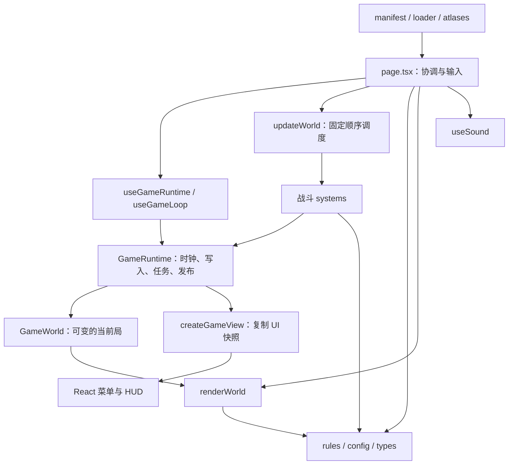
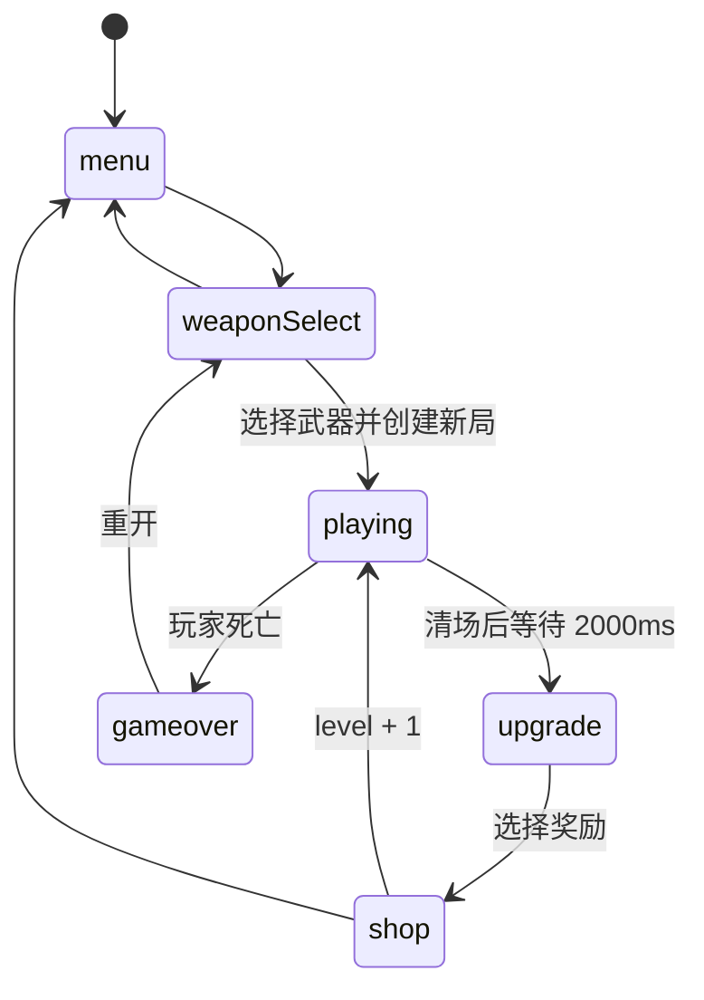

# 项目架构与开发规范

核验日期：2026-10-09；2026-10-10 更新地块加载与升级卡片资源恢复。范围：当前工作区的源码、配置、资源目录、工具脚本、回归用例及已有文档；不是仅针对 Git 提交版本的描述。本文整合原 `DESIGN.md` 的武器品质规范，作为后续维护入口。

**内容标记约定**：

- **当前实现（As-Is）**：已通过当前源码或文件核实。除非另有标记，第 1～4 章描述当前实现。
- **建议规范（To-Be）**：后续开发应遵循的原则，主要在第 5、7 章；不代表对应改造已经完成。
- **待改进事项（Technical Debt）**：实现差距与风险，以第 6 章的 TD 编号追踪。
- **待确认**：没有足够代码或实际运行证据，不能作为已实现能力或已通过验收的结论。

证据顺序：实际调用路径与类型/工厂 → 实际使用的配置 → 测试 → 历史文档。`README.md` 是脚手架说明；`docs/SYSTEM_BREAKDOWN.md`、`docs/ARCHITECTURE_OPTIMIZATION.md` 含旧单文件架构和未实施方案；`docs/GAME_DESIGN.md` 含玩法设想；`docs/P1-implementation.md` 是历史验收记录。它们不替代当前代码，例如“五关通关”和“只加配置即可扩展武器”均不是当前完整实现。

## 1. 项目概述

### 1.1 游戏与玩法范围

这是单人、2D 俯视角、像素表现的 Roguelite 射击游戏。玩家移动、鼠标瞄准并按住鼠标射击，击杀分批出现的敌人，拾取金币等掉落物；清场后选择升级、购买商品，再进入下一关。没有独立游戏引擎项目或场景资源文件：战场由 Canvas 绘制，菜单和阶段面板由 React 条件渲染。

已实现 WASD/方向键移动、E 闪现、R 换弹、滚轮及数字键换枪、Esc 暂停，以及失焦/隐藏页面自动暂停。当前普通斜向移动没有归一化；这属于已有规则，文档不将其改成等速移动。

### 1.2 技术栈与依赖边界

| 项目 | 当前使用方式与证据 |
| --- | --- |
| Next.js 16.1.1、React/React DOM 19.2.3 | `package.json`；App Router 的 `/` 入口为 `src/app/page.tsx`，`'use client'` 组件 `TopDownShooterGame` |
| TypeScript 5.x | 严格检查、`noEmit`、bundler 模块解析；`tsconfig.json` 定义 `@/* → src/*` |
| Canvas 2D、RAF、Web Audio API | 自写模拟、渲染、输入与音频；没有 Phaser、Godot、Unity、物理引擎或 ECS 依赖 |
| Tailwind CSS 4、shadcn/Radix UI | React 菜单、按钮、面板及基础组件；游戏页面直接使用 `Button`、`Card`，不能把整个 UI 组件库算成游戏功能 |
| pnpm 9 | `packageManager: pnpm@9.0.0`，`pnpm-lock.yaml`；脚本的安装入口限制使用 pnpm |
| Node 内置测试 + TypeScript 转译加载器 | `scripts/run-game-tests.cjs`、`register-typescript.cjs`、`tests/game-regression.cjs` |
| xlsx、Coze SDK、axios | 分别用于离线配置导出、图像/语音生成和下载脚本；不参与浏览器战斗循环 |

依赖清单还包含 AWS、Supabase、Drizzle、pg 等包，但当前 `src/` 未发现对应业务调用，也没有 API route、数据库连接、账号或云存档实现。游戏运行时的 `fetch` 用于本地音频资源，不能据此推断联网玩法。

### 1.3 功能完成状态

| 状态 | 功能与实际边界 |
| --- | --- |
| 已实现 | 六种阶段、固定步长战斗、五类武器、武器随机词条/品质、弹药/换弹/换枪、四类普通敌人和史莱姆王、三种敌人词缀 |
| 已实现 | 引火、淬毒、毒圈、气场、处决、暴怒二次暴击、吸血、弹药补充、低血量强化；升级、商店刷新、整组商品锁定、拾取和战斗特效 |
| 已实现 | 跟随玩家的基础照明、共享法线、可选 Alpha rim/明暗色阶、脚底软阴影与 WebGL 故障回退；玩家、普通敌人、Boss 和五种障碍均接入 |
| 已实现但存在缺陷 | 换枪后的属性/弹药一致性、部分战斗伤害路径；详见 TD-H02～H05。障碍索引 TD-H01 已修正，组合风险见 R01 状态 |
| 部分实现 | 毒系、手枪、RPG 成长链可进入候选池；RPG 组合效果存在数值问题。火系节点仅有配置/登记逻辑，未进入候选池，战斗系统也未消费其节点效果 |
| 部分实现 | 中英字典与切换已接入部分 UI/Canvas；配置文案、提示、特效文字仍有硬编码中文 |
| 已实现 | `tile1.png`～`tile5.png` 随图片加载，预绘制随机地面；部分缺图用可用地块，全部失败回退深色背景 |
| 仅占位 | 气场、处决、暴怒、吸血、弹药补充、险中取胜的后续成长链节点标注“预留”，仅追加节点 ID，无实际效果，且被候选池排除 |
| 未实现 | `victory` 阶段、五关后终局、局内存档/读档、局外永久成长、多角色、遗物、通用元素组合、联机、移动端触摸操作 |

第五关会安排 Boss，但 `exitShop()` 总是进入 `level + 1`，没有关卡上限或获胜分支。当前射击依赖 `isMouseDown`，不是自动瞄准/自动射击模式。

## 2. 项目架构

### 2.1 目录与职责

```text
src/
├─ app/
│  ├─ layout.tsx                根布局、开发 Inspector、页面元数据
│  ├─ page.tsx                  阶段协调、输入、资源装配、React UI
│  └─ globals.css               Tailwind 主题、像素字体
├─ game/
│  ├─ model/                    types.ts、World.ts、View.ts
│  ├─ config/                   base.ts、weapons.ts、monsters.ts、lighting.ts
│  ├─ runtime/                  GameRuntime、FixedStepClock、实体/局次工厂
│  ├─ rules/                    几何、属性、伤害、奖励、成长、候选与购买规则
│  ├─ systems/                  按固定顺序推进世界的战斗系统
│  ├─ render/renderWorld.ts     Canvas 世界、特效、HUD、暂停画面
│  ├─ render/lighting/          帧/几何适配、通用法线、WebGL 缓存与照明合成
│  ├─ assets/                   资源路径、图片加载、精灵图集
│  └─ index.ts                  配置/类型/规则/词缀的聚合导出
├─ hooks/                      useGameRuntime.ts、useSound.ts、通用 use-mobile.ts
├─ components/game/            AssetWidgets.tsx：卡片、提示、像素按钮等
├─ components/ui/              通用 shadcn UI 组件
├─ i18n.ts                     字典、语言读取与翻译
├─ constants/index.ts          旧配置路径的兼容再导出
├─ types/index.ts              旧类型路径的兼容再导出
└─ lib/utils.ts                通用 className 合并工具
public/assets/                 图像、字体、声音、导出的 buff_config.xlsx
public/assets/cutout/          美术加工输出与清单，未被游戏源码引用
scripts/                       启动/检查/导出/素材生成工具
tests/                         game/lighting 回归与隔离浏览器夹具
docs/                          历史分析、设计方案与验收记录
```

`src/app/robots.ts` 和脚手架 SVG、favicon、`public/test_images.html` 是外围页面/资源，不是战斗系统。配置、类型的权威位置为 `src/game/`，旧目录没有独立的第二份实现。

### 2.2 真实依赖与数据流



模拟系统通过 `UpdateWorldContext` 接收 `world`、`runtime`、setter、音效回调与少量页面 ref；B2 后碰撞几何（`checkCircleCollision` / `checkCollisionWithObstacle`）由 systems 直接引用 `rules/geometry.ts`，枪火/后坐力/震屏三个表现 ref 合并为单个 `viewFx` 字段传入。context 仍含 `canvasRef` 与音效/图像回调，因此目前并非完全脱离 React/DOM 的独立引擎。`rules/damage.ts` 还向上依赖 `systems/affixes.ts`；词缀对象同时包含规则与绘制方法。这些是现存边界例外，不应在新模块中扩大（TD-M01）。

世界对象由 runtime 持有，`runtime.state` 的对象身份保持稳定，字段和实体可被替换。页面常驻监听器通过这个稳定容器读取最新状态。React 读取 `view` 快照，Canvas 读取 `world` 实时数据；二者更新频率不同。

### 2.3 启动与阶段切换

1. Next 根布局加载全局样式，首页创建 `GameRuntime(createWorld(), Math.random, createGameView)`；初始阶段为 `menu`。图片加载遮罩是 React 状态，不是 `gameState` 的一种。
2. 图片并行加载、检查图集；必要资源失败时保留遮罩并提供重试。音频在首次 click/keydown 后初始化和预加载。挂载约一秒后还会递增 `imageVersion`，触发一次全量重新加载。
3. 菜单进入 `weaponSelect`；以 `WEAPONS[w].isStarter` 筛出手枪、散弹枪、冲锋枪。
4. `startGameWithWeapon()` 重置局数据及闪现/镜头/枪口等 ref，尝试生成障碍物/背景，调用 `startLevel(1)`，最后设为 `playing`。
5. 战斗中检查活敌与待生成批次。`canCompleteLevel()` 通过后只登记一次 2000ms 模拟任务，再生成升级选项、进入 `upgrade`。
6. `applyUpgrade()` 应用当前候选项的数值或成长节点，进入 `shop`。`exitShop()` 在事务中递增关卡、生成下一关敌人并回到 `playing`。
7. 玩家致死伤害设为 `gameover`；重开先回到 `weaponSelect`，选定武器才实际重置。菜单返回也只是切阶段，不等于重置世界。



暂停是 `playing + isPaused` 的正交标志，恢复通过 Canvas 继续按钮；Esc 只负责暂停。阶段改变会清除暂停；离开 `playing` 清理按住输入及所有模拟任务。暂停时任务保留，但模拟时钟冻结。BGM 按阶段启停，暂停标志本身不会停止 BGM。

### 2.4 每帧与每个模拟步

`useGameLoop()` 只注册一个 RAF，ref 更新回调。`FixedStepClock.advance()` 每帧最多补 6 个 1/60 秒步；超过约 100ms 的累计时间被丢弃。每步由 `GameRuntime.step()` 先推进模拟时间、执行到期任务，再调用 `updateWorld()`。

| 顺序 | 系统 | 主要读写 |
| --- | --- | --- |
| 1 | `waveSystem` | 待刷批次、交接时间 → monsters/下一波状态 |
| 2 | `movementSystem` | keys、武器、闪现请求、障碍物 → player/闪现状态 |
| 3 | `weaponSystem` | player、mousePos、按住状态 → 弹药、bullets、延迟第二发 |
| 4 | `projectileSystem` | 玩家弹体与敌人/障碍物 → 伤害、死亡、掉落、状态、爆炸 |
| 5 | `monsterSystem` | 词缀、DOT、玩家位置、障碍物 → 敌人状态/移动/传播/自爆 |
| 6 | `enemyAttackSystem` | 敌人、敌方弹体、Boss 状态 → 玩家伤害、Boss 技能、弹幕 |
| 7 | `zoneSystem` | 毒圈、气场 → 区域效果、死亡动画清理、毒圈治疗 |
| 8 | `pickupSystem` | coins 与玩家位置 → 拾取、属性、金币 |
| 9 | `effectSystem` | 时间与表现实体 → 飘字、粒子、烟雾等生命周期 |
| 收尾 | `updateWorld` | 重算活敌+待刷敌人、Boss UI 数据，再检查清场 |

`updateWorld()` 还处理后坐力/震屏衰减、枪口特效过期、1000ms 换枪结束。在每个系统返回后检查阶段，离开战斗就中止后续系统；不是在系统内部每次写入后立即中断。没有 Canvas 时跳过主要模拟逻辑。RAF 在 `playing` 时绘制，包括暂停画面；绘制不推进战斗时间。

## 3. 模块设计说明

### 3.1 运行时、工厂与 UI 快照

**入口**：`runtime/GameRuntime.ts` 的 `GameRuntime`，`runtime/FixedStepClock.ts`，`hooks/useGameRuntime.ts`；这里及以下省略的 `runtime/`、`rules/`、`systems/`、`model/`、`config/`、`render/`、`assets/` 均相对于 `src/game/`，`hooks/` 相对于 `src/`。

- `set(key, valueOrUpdater)`、`setter(key)` 同步改世界；同字段嵌套写入排队执行，避免 updater 覆盖。`transaction(action)` 合并通知，**没有回滚能力**。
- `schedule(callback, delayMs)`/`cancel(id)` 使用模拟时钟，任务带局次 ID；新局、卸载、离开战斗会取消。到期任务按时间、任务 ID 排序。本步执行期间新增任务不在已取出的到期列表中。
- `now()` 初始为 1,000,000，每步递增 `1000/60`，不是 Unix 时间；`random()` 默认来自 `Math.random`，构造时可注入，未提供产品级种子/回放功能。
- `nextId(prefix)` 生成带局次和递增序号的 ID；`claimDeath(id)` 在单局去重死亡奖励；`resetRun()` 清任务、死亡记录和时钟，但不负责重建全部字段。
- `createPlayer()`、`createMonster()`、`createWorld()` 定义默认数据；`createRun()`/`resetRunWorld()` 重建局数据，保持当前阶段供页面完成后续切换。
- `subscribe/getSnapshot` 接到 `useSyncExternalStore`。`publish()` 战斗中通常最多每 100ms 发布一次，阶段/暂停变化立即发布。`createGameView()` 使用 `structuredClone` 复制 UI 所需字段，没有复制怪物/弹体/粒子全集。

约束：UI snapshot 内不可放函数、DOM 或类实例。`runtime.state` 仍公开可变，“单写入者”是约定而非完全的类型封装。新增需显示的数据必须同步加入 `GameView` 与 `createGameView()`；不要把不可变快照传回系统当权威状态。

### 3.2 阶段协调、输入与地图

**入口**：`src/app/page.tsx` 的 `startGameWithWeapon/startLevel/checkLevelCompletion/exitShop` 和键鼠监听；`systems/movementSystem.ts`、`rules/geometry.ts`。

页面持有加载/设置/语言/最高分、资源对象、镜头与闪现 ref，并装配两个 context。移动键写入 `world.keys`，鼠标位置为浏览器 client 坐标；E 写入 `dashPendingRef`，由移动系统消费。输入框/可编辑区域过滤键盘命令；阶段、暂停、blur、visibilitychange、pointercancel 和鼠标释放处理清理输入。

闪现冷却 5000ms，按触发时移动方向归一化，位置曲线在 400ms 内完成 350px 位移，再受边界/障碍物限制；无方向也会消耗冷却。射击、接触伤害、敌方弹体和自爆检查闪现状态，**Boss 落地伤害没有相同检查**，不能宣称所有伤害下都无敌（TD-H05）。曲线实际加速，与源码“EaseOut/减速衔接”的注释不一致。

障碍物设计为新局随机放置 24 个，中心排除半径 200px、物体中心间距至少 220px、每个最多尝试 1000 次，按图片比例缩到最大边 100px；碰撞矩形使用独立比例。生成入口现已按 imagePath 取图（R01 修正），目标数量、中心排除和间距由真实页面回调回归覆盖。几何函数计算圆与居中碰撞矩形、点到矩形距离；没有网格寻路或空间索引。

地面由 `manifest.ts` 的 tile1～tile5 经 `loadImageAsset()` 加载，按资源声明顺序收集。`page.tsx::generateMapBackground()` 在图片更新和新局开始时，将现有 625×350 图片缩到 1/6，随机平铺到 6000×6000 离屏 Canvas；保留原有 20% 黑色层与 80% alpha 处理。花纹使用表现随机 `Math.random()`，不调用 `runtime.random()`；地图没有碰撞语义。`renderWorld()` 按世界坐标绘制缓存，再叠加光影；全部 tile 失败时清除旧缓存并用纯色背景。单张缓存像素约 137MiB，沿用整图方案，未作分块优化；挂载版本重载仍可能重复生成。

### 3.3 武器、装备属性与弹药

**入口**：`config/weapons.ts` 的 `WEAPONS`，`runtime/createPlayer.ts`，`rules/weapons.ts`、`combatStats.ts`、`stats.ts`，`systems/weaponSystem.ts`；换枪命令仍在页面 `switchWeapon/switchWeaponTo`。

`Player.weapons` 是唯一武器类型列表，按类型保存 `weaponInstances` 和 `weaponAmmo`，不是可持有多把同类型武器的库存。初始武器没有随机词条；首次获得实例时 `rollWeaponInstance()` 先抽次数，再均匀选词条种类、按权重选档，允许重复词条；再次获得同类型沿用实例。

`deriveCombatStats(player, now)` 提供有效暴击、暴伤、换弹、移速、射程和弹匣值。`damage/fireRate/weaponRange` 等当前直接存于 Player；加成字段同时用于记录/展示，不能假定都可重新计算或持久跨枪生效。

射击由当前武器配置生成 Bullet，一次射击扣一发弹药；散弹枪发 5 个弹体。空弹匣自动换弹，R 主动换弹；散弹逐发装填，已有弹药时按住射击可取消换弹。普通换枪保存旧弹药、恢复目标弹药、取消换弹并限制射击 1000ms。

手枪末弹节点使用高穿透值 9999；孤注一掷调整最后三发伤害/末弹暴击与换弹。RPG 直接伤害为零，实际伤害来自爆炸：基础参数在系统中硬编码为伤害 120、半径 150，未直接采用 `WEAPONS.rpg.damage=84`；第二发通过 700ms 模拟任务产生。装备、升级装备、商店获取、回填弹药有不同路径，相关差异属于 TD-H02/H04，而非新增功能可依赖的规范。

### 3.4 玩家弹体、伤害与死亡

**入口**：`systems/projectileSystem.ts`、`explosion.ts`、`death.ts`、`rules/damage.ts`。

弹体每步移动，按距离/边界/障碍物移除；RPG 命中、射程到达、边界或障碍物触发爆炸。普通命中更新 `hitCount`，后续伤害按 `0.5^(hitCount-1)` 衰减且至少 1 点，`isPistolLastBullet` 为不衰减例外。没有记录每枚弹体已经击中的敌人集合（TD-H04）。

`resolveMonsterDamage({target, amount, source, interceptAffix, respectInvincible})` 返回修改后的词缀状态、实际伤害、blocked 和计算后的 hp，**不会自行写回 World、播放表现或发放掉落**。`source` 当前用于标识，真正拦截策略由两个布尔字段决定：

| 来源 | 词缀拦截 | 尊重无敌 | 当前额外逻辑 |
| --- | --- | --- | --- |
| 普通弹体 | 是 | 是 | 暴怒、处决、引火/淬毒、击退、暴击击杀补弹 |
| RPG 爆炸 | 是 | 是 | 固定 60/120/150px 分段伤害、冲击波；独立掉落分支 |
| 自爆伤害其他敌人 | 是 | 是 | 自爆者与周围敌人分别结算死亡 |
| 燃烧/中毒 DOT、毒圈 | 否 | 否 | 保留绕过护盾/无敌的来源策略，不能擅自统一 |
| 气场 | 不适用 | 不适用 | 当前仅击退、减速、消弹，无直接伤害调用 |

`settleEnemyDeath(runtime, target)` 是共享的死亡登记与 +10 分入口；成功后标记 hp=0/isDying/deathTime，返回是否首次结算。掉落、吸血、传播和飘字仍由各来源处理，**没有统一 loot/reward 系统**。同字段嵌套死亡标记由 runtime 排队落地，调用方仍需返回正确实体。`zoneSystem` 在 200ms 死亡表现后清理敌人。

### 3.5 敌人、刷怪、Boss 与敌人词缀

**入口**：`config/monsters.ts`、`runtime/createMonster.ts`、`systems/spawnMonsters.ts/waveSystem.ts/monsterSystem.ts/enemyAttackSystem.ts/affixes.ts`。

`startLevel()` 总权重为 `3+2(L-1)`，第二关特例为 4；普通敌人 HP 倍率为 `(1.1+0.1(L-3)+0.035(L-3)^2)*1.25`。数量、类型概率、每种最多 300 个、视口外位置与速度 ±10% 波动由 `spawnMonsterWaves()` 硬编码。第一关仅类型 1，第二关保证类型 2，第三关引入类型 3，第四关起混合类型 1～4。

第五关额外创建基础 HP=1560 的 Boss，不使用普通敌人 HP 倍率。随后**所有敌人（含 Boss）一起洗牌**，每批 `ceil(总数*0.25)`；所以 Boss 不保证最后出现。待刷实体已在关卡开始时创建；后续批次出场时重新定位，原有时间字段不会重新初始化。

下一批在 15 秒到期或当前活敌少于本批初始数 30% 时启动交接。代码总交接时间为 `4000+2000+300+500+3000=9800ms`，期间继续战斗。后续批次定位使用硬编码 1280×720，和真实 1200×800 视口不同（TD-M03）。清场检查直接看活敌及待刷批次，不能只用 HUD 计数判定。

普通 AI 寻向玩家、前瞻采样避障、沿墙滑动及卡位推出；Boss 可穿过障碍物。类型 4 在距离 <600 时按配置周期射击；接触伤害按怪物独立 CD，普通敌人取 `damage*0.1`，Boss 取 `damage*2`，所以配置 damage 不是最终所有攻击的伤害。

Boss 远程攻击生成两组 3×15 弹体；跳跃状态为 `idle → locking → jump_start → airborne → landing → recovery → idle`，从起跳到落地结算前设置无敌。落地造成范围伤害/击退并生成旋转弹幕。`recovery` 的“停止移动”仅有注释，移动系统未排除该阶段；DOT 更新也可能被 Boss 的旧对象返回覆盖（TD-H03）。

`AffixSystem` 是包含静态函数的普通对象，**没有 Affix 基类继承体系**。`init/onDamage/update/render/renderBelowHpBar` 共享 `Monster.affix` 和 `affixState`：每敌人最多一个词缀；狂暴在低血时改变速度、伤害与攻击周期；护盾抵挡前三次受拦截的伤害事件；自爆近身充能后造成范围伤害。新增词缀需同时处理数据、伤害/更新与视觉入口。

### 3.6 Buff、DOT 与区域效果

**入口**：`rules/effects.ts/growth.ts/stats.ts`，`projectileSystem`、`monsterSystem`、`zoneSystem`。

- 引火/淬毒在普通非致死命中后按 `0.2*等级` 概率附加，最多五层并刷新到期时间。基础持续 5000ms；燃烧每 1000ms、中毒每 1000ms（毒系节点可到 700ms）结算。燃烧死亡传播与毒传播使用模拟任务。
- 中毒附带 20% 减速；中毒 DOT 或毒圈致死可生成毒圈，普通弹体击杀中毒敌人的分支没有相同生成逻辑。基础半径 `60+20*等级`、持续 5000ms、每 500ms 伤害一次、最多 5 圈；成长辅助函数影响半径/持续/毒伤/传染/站圈回复。
- 气场半径 `90+15*等级`，每 3000ms 击退圈内敌人、附加 1500ms 减速并清敌弹。
- 处决在普通弹体结算后 HP 低于 18% 且仍存活时触发；暴怒只在首个暴击命中分支检测二次暴击。吸血在普通弹体与爆炸击杀分支检测 10% 概率回 1HP，DOT 击杀没有相同处理。弹药补充在暴击/二次暴击的普通弹体击杀分支生效。
- 险中取胜在 `hp < maxHp*0.2` 时启用；派生规则提供暴击率 +20 百分点、暴伤加成 +100、射击间隔 ×0.7、换弹加成 +30、移速 +1。当前按是否拥有判定，并非等级线性增强。

约束：Buff 并非通用事件插件，效果分布在具体伤害来源中。不能把“存在等级字段/说明/成长节点”当作完整触发链已接入；新机制必须列出作用来源和可获得途径。

### 3.7 升级与成长链候选

**入口**：`rules/offers.ts::buildUpgradeOffers`、`upgradeEffect.ts::applyUpgradeEffect`、`growth.ts`，页面 `applyUpgrade/refreshUpgrades`。

动态升级池直接在 `buildUpgradeOffers()` 构建，按关卡计算 value/weight，过滤上限及已获取的基础 Buff，最多抽 3 个不同 `Upgrade.id`。`rules/rewards.ts::UPGRADES` 静态数组仍导出，但未用于页面实际抽取。

`Upgrade.value` 是效果输入；不从中文 description 解析。普通升级由 `applyUpgradeEffect()` 分派，成长升级由 `GROWTH_CHAIN_NODES[nodeId].apply()` 分派。后者通常只登记节点 ID，再由对应战斗规则检查。升级每关允许免费刷新一次。

成长链解锁检查：未拥有节点、有基础 Buff/当前持有对应武器、上一 tier 的同 baseBuff 节点数达到 `requiredPrevTierCount`。毒系 T3 要求两个 T2 节点。手枪/RPG 判断的是**当前装备武器**，不是背包拥有；相关文案注释不准确。

候选池显式只允许毒系、手枪、RPG 节点，火系和“预留”节点不会出现。多个毒系节点共用 `id='poisonBuff'`，升级抽取按 id 去重，因此同一组选项最多包含一个该类成长节点。`weight || 1` 会让零权重升级仍有一次入池机会（TD-M02）。

### 3.8 商店与经济命令

**入口**：`rules/rewards.ts::SHOP_ITEM_CONFIGS`、`rules/effects.ts::SHOP_EFFECTS`、`offers.ts::buildShopOffers`、`shop.ts::buyShopOffer`；页面管理进入、刷新与锁定。

`buildShopOffers(player, level, preserved, random, nextId)` 保留最多三个实例，补齐到三项；普通候选类型为硬编码列表。商品可以重复类型，成长节点也可能同屏重复；没有通用唯一性/互斥规则。已取得的八类基础机制 Buff 从新候选池移除，因此通常只能获得一次基础等级。

商品实例保存 `id/type/value/price/growthChainNode`。`buyShopOffer(runtime, id)` 在事务中从当前商品列表查 ID、检查阶段与余额，应用效果、扣钱、移除商品和锁定副本，防止对同 ID 重复扣款；**没有重新检查已经拥有的成长节点或属性上限资格**（TD-M02）。

锁定按钮锁/解锁整组商品，跨关卡保留 ID、价格、数值；不是逐项锁定。刷新使用锁定列表重建，其首次价 `5+floor(L/2)`，后续价 `floor(旧价*1.2)`。锁定且购买后不足三项时，页面 Effect 用同一生成函数保留剩余商品并补货。

约束：UI 应只传 ID，请求由权威 World 消费；不得用 UI 快照中的价格/效果直接扣钱。页面刷新/锁定仍是多次 setter，尚未统一成 runtime 命令 API。

### 3.9 掉落、拾取与表现生命周期

**入口**：`projectileSystem/explosion/monsterSystem/zoneSystem` 产生掉落；`pickupSystem` 消费；`effectSystem` 更新表现。

`world.coins: Coin[]` 实际容纳四类物品：`coin/chest/weapon_upgrade_box/health_potion`。金币/宝箱增加 gold；武器箱固定升级一级、当前属性 +3% 并补弹；治疗瓶回复 `floor(5+1.2L)`，受 maxHp 限制。吸附范围为 `80*(1+coinPickupRangeBonus/100)`，拾取后用动画进度延迟移除。

普通弹体、爆炸、DOT、毒圈掉落不同；武器箱和治疗瓶目前只在 `explodeWorld()` 的掉落分支生成。毒圈击杀类型 3/4 固定 2 金币、Boss 为 `floor(goldBase*L*0.4)`，其他来源不能自动套用该规则。未来统一掉落前必须明确要保留哪些差异。

`accumulatedDamage` 用 Map 合并同敌人飘字，最后命中后 **100ms** 释放（旧注释写 0.3 秒）；伤害/金币飘字 1000ms，烟雾/爆炸/穿透/吸血效果按各自寿命清理。特效数据由模拟推进，绘制只读取；相机平滑则由渲染时间推进。

### 3.10 Canvas 与 React 表现

**入口**：`render/renderWorld.ts::renderWorld(RenderWorldContext, deltaTime)`、`src/components/game/AssetWidgets.tsx`、页面 JSX。

Canvas 绘制背景、边界、障碍、弹体、怪物/词缀、掉落、区域、玩家/武器、飘字、波次公告、HUD 与暂停画面；镜头由死区、指数平滑、滞后上限和世界边界钳制组成。屏幕 HUD 用保存的基准矩阵脱离镜头。精灵帧使用 `SPRITE_ATLASES/atlasFrame()`；纯视觉震屏/枪体抖动用 `Math.random`，不消耗 runtime 的随机源。

React 绘制加载、菜单、选武器、升级、商店、结束、设置、Buff 预览及部分 HUD。`AssetWidgets.tsx` 导出 `CoinIcon/UpgradeCard/ShopItemCard/SpecialRewardTooltip/PixelButton`；卡片仅回调业务命令。`UpgradeCard` 通过 `ASSET_PATHS.upgradePanel` 使用 `/assets/win_1.png` 作为背景；它是关卡升级卡片，不代表终局胜利阶段。`PixelButton` 加载到离屏 Canvas，按映射后的 alpha>30 做鼠标命中判断。

约束：绘制不得修改 World/战斗冷却/伤害/掉落；允许更新镜头 ref。当前没有完整视口剔除，基础 Canvas 为 1200×800，没有统一缩放坐标转换；枪口宽度/偏移同时在射击和绘制中维护（TD-M03）。

### 3.11 图片加载与资源身份

**入口**：`assets/manifest.ts::ASSET_PATHS`、`loader.ts::loadImageAsset`、`atlases.ts`、页面加载 Effect。

`AssetSpec` 字段为 key、src、可选 required/type/setter。加载器先设 onload/onerror 再设 src，附加版本查询参数，默认 15000ms 超时，支持 AbortSignal；结果明确区分 loaded/failed/aborted。页面统计完成率，默认把 `required!==false` 的失败视为阻塞；重试通过递增版本重新加载全部图片。

`SPRITE_ATLASES` 定义宽高、frameMs、帧矩形和 anchor，`validateAtlas()` 校验尺寸与矩形越界；非图集 key 不做尺寸校验。`ASSET_PATHS` 并未覆盖全部 UI/奖励图片，部分路径仍写在配置和 JSX。`Obstacle.image` 与 `obstacleImages` 使用相同资源路径；生成入口已修正为 imagePath，大小写沿用 manifest（含 `Obstacle_4.png`）。

### 3.12 音频、语言与本地设置

**入口**：`src/hooks/useSound.ts`、`src/i18n.ts`、页面的语言/最高分 Effect。

`useSound()` 提供 `play/playBGM/stopBGM/toggleMute/setVolume/preloadSounds`。`SOUND_CONFIGS` 指定合成或文件、音量、可选限流；开火/死亡/爆炸/按钮/金币用合成，关卡提示与 Boss 提示用 MP3；BGMGenerator 按 140 BPM 的浏览器 interval 调度 Web Audio。文件缓存是模块级 `Map<string, AudioBuffer>`。限流用 Date.now，播放用 AudioContext 时钟，与战斗模拟时间分开。

默认未静音、音量 0.7，卸载停止 BGM 并关闭 AudioContext。BGM 按 playing 阶段启动，离开停止；长局节点回收和播放生命周期待完善（TD-M04）。`game_over` 有配置且对应 MP3 文件存在，但未发现播放调用，不能把资源配备等同于结束音效已接入。

语言默认为 zh，支持 zh/en；`translate()` 将点号转换为下划线，缺 key 返回原 key，缺目标语言回落中文。语言有 localStorage 读取和写入辅助函数，但设置按钮只调用 setLanguage，未调用保存辅助函数；因此当前 UI 切换不会持久化。最高分会在 gameover 时保存，详见 4.6。没有保存音量、当前武器、金币或关卡进度。

### 3.13 光影表现（As-Is）

**入口**：`config/lighting.ts`、`render/lighting/lightingRenderer.ts::LightingRenderer`、`renderWorld.ts`；实施计划和验收分别见 `docs/LIGHTING_PLAN.md`、`docs/LIGHTING_VALIDATION.md`。

页面 Effect 创建/释放一个 renderer，设置面板管理表现配置；`RenderWorldContext.lighting` 是兼容旧调用的可选字段。光影不进入 World、模拟系统、战斗随机或第二个 RAF。菜单/暂停的质量设置只影响画面；暂停隐藏左下武器栏，避免其拦截 Canvas 设置按钮。

- `spriteLayout.ts::playerSprite/monsterSprite` 共享原动画帧、尺寸、居中锚点和镜像规则。`renderWorld` 在真实镜头钳制/震屏之后生成描述，障碍通过 manifest 路径匹配材质；实体、武器、弹体等世界遮挡顺序保留。
- `normalProfiles.ts` 生成球面、胶囊、倒角三种64²模板，放入含1px边框的198×66 RGBA8图集（52,272字节）。资源首次出现时按所有帧扫描 Alpha≥32 的稳定范围，玩家三组动画再合并；范围不改变原图裁剪和最终透明度。尺寸只改变 UV/法线斜率，镜像同时翻转法线 X。
- `prepareFrame` 仅着色视口与光圈相交的目标，写入有限的2048×1024离屏 WebGL 图集；Canvas 在原身体位置通过 `drawSprite` 取槽位。每个目标一次 GL draw，全部 GL 提交先于主 Canvas 取图；没有逐对象 CPU 像素读回、逐帧法线或实例专用贴图。容量外、圈外对象接受基础照明。
- `applyBase` 在世界绘制后施加一次缓存的 Canvas RGB 倍率场。`B=clamp(环境色×环境强度+光色×光强×距离衰减, floor, 1)`；法线通道输出 `K=T/B`（T包含受光方向），最终相乘得到 T，避免二次距离衰减。 shader 输出预乘 Alpha；原色最近邻、法线线性采样。
- 血条/词缀血条UI、Boss预警、伤害/金币字、换弹提示、闪现HUD在倍率场之后按原提示相对顺序绘制，保留世界/屏幕坐标。它们现在位于世界主体之上，这是明确的可读性层级调整。词缀主体光环、爆炸、烟雾、弹体、武器等仍接受基础照明；没有新增特效光源。
- `basic` 只有倍率场；`standard` 加共享法线与按材质开启的脚底椭圆；`high` 再加 Alpha 四邻域 rim。色阶可独立开关。火盆也只是受光素材；障碍法线不产生挡光、几何投影或视野判定。

GPU 原色按**图像对象身份**缓存、动画换帧不上传；页面版本重载会产生新图像对象并替换旧缓存，外部调用不得仅原地修改同一 image.src。超过 MAX_TEXTURE_SIZE 的素材按现有帧矩形重排分页，保留 boss2 尾帧真实宽度；不改源文件。固定输出/合成预算16MiB，新增 GPU 估算预算64MiB，超限按素材回退并诊断；不是浏览器总内存上限。

WebGL不可用、着色器/驱动上传失败时全通道回退 basic；context lost 清槽位/GPU引用并继续 Canvas，restored 一次重建并复用CPU范围元数据；不逐帧重试初始化。`dispose` 移除监听、释放纹理/程序/缓冲/画布并在扩展可用时主动释放 context。`getDiagnostics` 提供模式、失败原因、上传/扫描/目标数量及内存估算；只有 `lit=requested` 且无失败原因才表示本帧目标完整覆盖。

## 4. 配置与数据规范


### 4.1 来源与加载方式

| 文件 | 权威数据/用途 | 生效流程 |
| --- | --- | --- |
| `src/game/config/base.ts` | GAME_CONFIG、MAX_VALUES | ES 模块直接 import，系统/规则读取 |
| `src/game/config/weapons.ts` | 武器、品质、抽取次数、词条、初始展示 | 工厂/装备/射击/候选/UI 分别读取 |
| `src/game/config/monsters.ts` | 敌人、词缀、词缀概率、Boss 弹幕 | 工厂/生成/攻击/绘制读取 |
| `src/game/config/lighting.ts` | LIGHTING_DEFAULTS、材质预设、缓冲/纹理预算 | 页面配置 → LightingRenderer；只影响表现，不参与伤害/碰撞 |
| `src/game/rules/rewards.ts` | 静态 UPGRADES、商店元数据、特殊提示文案 | 商店用 SHOP_ITEM_CONFIGS；升级实际池在 offers.ts |
| `src/game/rules/offers.ts` | 动态升级公式、候选白名单、商品数值/定价分支 | 每次进入/刷新时生成实例，非热加载数据文件 |
| `src/game/rules/growth.ts` | GROWTH_CHAIN_NODES、VALUE_TIERS、毒系辅助规则 | 解锁/入池/购买/战斗读取，含 apply/priceFormula 函数 |
| `src/game/assets/manifest.ts/atlases.ts` | 图片身份与图集规格 | 页面装配、加载校验和绘制读取 |
| `src/hooks/useSound.ts`、`src/i18n.ts` | 声音表、语言字典 | 浏览器音频与 UI 读取 |
| `public/assets/buff_config.xlsx` | 旧导出参考表 | 浏览器未读取，不驱动游戏；当前文件 9 张表，Player 表 43 行字段，和现有模型不同 |
| `public/assets/cutout/cutout-manifest.json` | 美术处理来源、hash、尺寸/透明区域记录 | 非运行时配置，记录中的机器路径不应当作项目依赖 |

配置都是代码常量/函数，依赖打包生效，没有 JSON/Excel 配置加载器或通用运行时 schema/热更新协议。光影配置单独通过 normalizeLightingConfig 做有限值、范围和缺省回退。`scripts/generate-buff-excel.ts` 单向导出工厂/配置与部分手写字段说明，当前脚本会生成 10 张表，函数写成 `[function]`；并未完整包含动态候选/系统硬编码规则，“当前生效配置”表名也不能代表完整玩法规格。默认输出会覆盖现有 xlsx，审阅时须显式指定外部临时路径。

工程配置：`next.config.ts` 只配置开发 origin 与远程图片域名；`components.json` 管理 shadcn 生成风格/别名；`postcss.config.mjs` 启用 Tailwind；`eslint.config.mjs` 配置 Next/TS 检查和 CJS 例外。`layout.tsx` 保留脚手架元数据与 `html lang=en`，不改变游戏语言状态。

### 4.2 单位与通用参数

所有数值字段为 `number`，除显式 boolean/string/数组/Map/Set 外没有额外运行时类型约束。

| 字段/类别 | 当前值及含义 |
| --- | --- |
| `WORLD_WIDTH / WORLD_HEIGHT` | 6000/6000，世界坐标 px；实体 x/y 在世界空间 |
| `CANVAS_WIDTH / CANVAS_HEIGHT` | 1200/800，视口和画布逻辑尺寸；mousePos 存 client 坐标 |
| `PLAYER_SIZE/PLAYER_MAX_HP` | 25 的碰撞半径用途、20HP；实际玩家绘制尺寸独立 |
| `OBSTACLE_COUNT` | 24，新局放置数量目标；生成失败可少于目标 |
| `HIT_EFFECT_DURATION/HIT_SLOWDOWN_FACTOR` | 200ms、0.5；命中表现/减速，死亡清理复用时长 |
| `COIN_PICKUP_RANGE/COIN_PICKUP_RANGE_MAX_BONUS` | 80px、500 百分比加成上限；最大目标范围 480px |
| `MAX_POISON_CIRCLES` | 5 |
| `ENERGY_AURA_BASE_RADIUS / ENERGY_AURA_SHOCKWAVE_INTERVAL` | 90px、3000ms |
| `ENERGY_AURA_KNOCKBACK_DISTANCE / ENERGY_AURA_SLOWDOWN_DURATION / ENERGY_AURA_SLOWDOWN_FACTOR` | 30px、1500ms、0.5；系统以 `1-factor` 乘速度 |
| 未被当前 src 调用的 GAME_CONFIG 值 | PLAYER_SPEED=3.5、BULLET_SPEED=7、BULLET_SIZE=5、MONSTER_SIZE=20、OBSTACLE_MIN_SIZE=60、OBSTACLE_MAX_SIZE=150、OBSTACLE_AVOID_DISTANCE=120、OBSTACLE_AVOID_FORCE=4、MIN_PASSAGE_WIDTH=50；修改这些不会自动改变当前对应玩法 |

时间戳/间隔使用模拟 ms；普通位移速度、弹体 vx/vy 以“每个 60Hz 模拟步的 px”使用。击退向量在部分路径按 px/s 再乘 1/60，闪现曲线使用 px/ms；不能仅凭字段名将所有速度统一乘 dt。

暴击率配置为 0～1 小数；`critRateBonus/critDamageBonus/reloadSpeedBonus` 等通常为百分比整数（20 表示 +20%）。`damageBonus/playerSpeedBonus/weaponRangeBonus` 在不同效果路径存在单位混用，不能视为一致 schema（TD-H02）。

`MAX_VALUES`：playerSpeed=7、weaponRange=2000、penetration=15、knockback=10、weaponUpgrade=500、critRate=1.1 原始率、critDamageBonus=1.5（相当于 150 百分比加成）。这是候选过滤/部分效果的阈值，**不是所有写入入口统一执行的约束**。有效暴击率原始值≤70%时全收益，70%～110%增量减半，再封到90%；暴伤在额外150%以上增量减半，没有同样的最终硬上限。换弹时间 `floor(max(250, base/(1+bonus/100)))`，手枪孤注一掷再乘1.4。

### 4.3 武器与品质配置

`WeaponConfig` 必填 id、名称/描述/图标、damage、fireRate（ms 间隔）、bulletSize、bulletSpeed、bulletRange、bulletsPerShot、spreadAngle（弧度）、color、critRate、magazineSize、reloadTime、isLongGun、isStarter；可选 playerSpeedBonus 默认0、playerSpeedMultiplier 默认1。

| 武器 | damage | fireRate | bulletSpeed | range | 弹匣/基础换弹ms | 暴击率 | 初始可选 |
| --- | ---: | ---: | ---: | ---: | --- | ---: | --- |
| pistol | 5 | 300 | 2.5 | 800 | 12 / 3000 | 0 | 是 |
| shotgun | 15×5 弹体 | 800 | 3 | 300 | 7 / 500（每发） | 0.2 | 是 |
| sniper | 50 | 1200 | 5 | 1500 | 8 / 3000 | 0.1 | 否 |
| smg | 6 | 80 | 3.5 | 400 | 30 / 2500 | 0.1 | 是 |
| rpg | 配置84，实际基础爆炸120 | 2000 | 配置1.2，实际火箭0.3→5 | 800 | 1 / 3000；两联装规则取2 | 0 | 否 |

手枪速度 bonus=0.5，RPG 速度 multiplier=0.7。`createPlayer()` 开局基础移速为2，手枪开局2.5；`applyWeaponStatsToPlayer/equipWeaponFields` 使用基础1，是现存差异，原文“初始为1”不能直接沿用。

品质由 `WeaponInstance.value=sum(affix.gain)` 决定，武器栏显示品质名/颜色、随机词条、价值：

| 档位 | 名称 | 最低价值 | 颜色 |
| --- | --- | ---: | --- |
| 1 | 普通 | 0 | `#ffffff` |
| 2 | 精良 | 30 | `#4ade80` |
| 3 | 稀有 | 50 | `#60a5fa` |
| 4 | 史诗 | 70 | `#c084fc` |
| 5 | 传说 | 100 | `#fb923c` |

抽取0/1/2/3/4/5次权重为120/320/280/170/80/30。五种词条种类等概率，以下三档权重均为100/80/60：

| 词条 | 三档 value | 三档 gain（价值） |
| --- | --- | --- |
| magazine | 1/3/6 发 | 5/12/20 |
| moveSpeed | 3/5/8% | 5/10/18 |
| damage | 10/15/20% | 15/30/60 |
| critRate | 10/15/20% | 8/18/35 |
| fireRate | 10/15/20% | 12/25/50 |

### 4.4 敌人、词缀与 Boss 配置

`MONSTER_CONFIGS` 用 `MonsterType=1|2|3|4|5` 索引；字段含 name/size/baseSpeed/hp/damage/color、canShoot/shootInterval/bulletSpeed/bulletDamage/bulletRange/goldBase，以及可选 Boss 远程/跳跃参数。`createMonster()` 的 hpMultiplier 默认1，baseSpeed 默认配置，speed 默认 baseSpeed，isBoss 取配置值、缺省 false；其余可选状态按使用路径补充。

| 类型 | HP基数 | 基础速度 | damage字段 | 射击 |
| --- | ---: | ---: | ---: | --- |
| 1 标准 | 16 | 1.1 | 10 | 否 |
| 2 中型 | 33 | 0.6 | 15 | 否 |
| 3 大型 | 137 | 0.35 | 30 | 否 |
| 4 远程 | 33 | 0.7 | 5 | 5000ms、速度1.3、伤害2、射程500 |
| 5 Boss | 1560 | 1.1 | 10 | 专用远程/跳跃/落地弹幕 |

`AFFIX_CONFIGS` 的 type/name/description/weight 定义三种词缀，当前权重均100。生成概率由 MIN_LEVEL=4、BASE_CHANCE=0.05、CHANCE_PER_LEVEL=0.01、MAX_CHANCE=0.25 控制。BERSERK_CONFIG 定义30%血线、速度+60%、伤害+50%、间隔×0.5及颜色；SHIELD_CONFIG 定义3层和视觉；SELF_DESTRUCT_CONFIG 定义80px触发、2000ms引信、120px范围、maxHp×0.3及粒子。

Boss 跳跃配置：检测7000ms/800px，锁定3000ms，起跳900ms，空中1600ms，落地13伤害/100px，恢复3000ms。旋转弹幕由 `BOSS_BARRAGE_CONFIG` 定义15口、100ms间隔、2000ms持续、240°/s旋转、速度8、伤害8、射程800、视觉直径60等。可选参数部分用 `|| 默认值`，填0会回落默认，不能默认0表示禁用。

### 4.5 候选、效果与价格数据

| 结构 | 字段与约束 |
| --- | --- |
| `Upgrade` | id: UpgradeType；value:number；name/description/icon:string；weight?:number；growthChainNode?:GrowthChainNodeId；id 是类别，节点身份另外存 |
| `ShopItem` | id:string（实例唯一）；type:ShopItemType；value/price:number；展示字段；growthChainNode 可选；锁定保存实例而非重新抽数值 |
| `SHOP_ITEM_CONFIGS` | name/icon/basePrice/levelPriceFactor/isPercentage/apply 必填，weight 可选默认100；isPercentage 只控制文案格式，不决定效果单位 |
| `GrowthChainNode` | id/baseBuff、tier/requiredPrevTierCount:number、weight:number或函数、priceFormula(level)、icon、apply(player)；缺基础/前置不入池 |
| `VALUE_TIERS` | value:number或函数、weightFormula(level)；普通商品的数值候选，不用于所有特殊 Buff |

常见动态升级：伤害 `floor(12*(1+0.04L))%`、maxHp `floor(1+0.5L)`、暴击率4、暴伤 `floor(20*(1+0.02L))`、射速10、换弹12、移速0.1、弹匣2、射程0.15、穿透1、击退1；治疗`12+4L`，金币`10+4L`，武器升级value=1。各自权重以 `buildUpgradeOffers()` 为准，不能采用静态 UPGRADES 的旧值。

普通商品按 VALUE_TIERS 抽 value：`floor(1+L/2)`、`floor(5+L/1.5)`、`floor(10+L/1.2)`、`floor(2L)`，权重为100、30+2L、10+2L、10+L。一般价 `floor(basePrice+levelPriceFactor*L+2*value)`；武器/穿透按基础价+关卡系数，机制和击退等有覆盖分支。例：击退15+18L、拾取范围3L+5、处决30+3L、暴怒floor(25+1.5L)、吸血/补弹10+2L、险中取胜20+3L。最终应检查 offers.ts，不能仅改 rewards.ts 的 basePrice 就期待覆盖生效。

**新增字段的建议规范（To-Be）**：先定义含义、单位、默认值、修改者和重置时机，再更新类型/工厂/消费函数/视图。保持 value 与文案分离；禁止用文案解析效果。配置新增必须检查调用方是否实际读取、候选白名单是否纳入、上限是否在效果路径执行。零权重排除、合法范围校验目前不统一，需要显式补充规则后才能作为全局保证。

### 4.6 运行时与持久化生命周期

| 数据 | 创建/修改者 | 保存与重置 |
| --- | --- | --- |
| `GameWorld` | createWorld/createRun；runtime setter 和各系统 | 只在内存，新局完整重建字段；没有序列化存档 |
| `Player` | createPlayer；移动、战斗、效果、商店 | 坐标/HP/金币/装备/加成/Buff/节点/动画共处一个对象；新局重置 |
| `Monster` | createMonster/生成；AI、伤害、状态/攻击 | 待刷批次也存完整实体，死亡后延迟清理，新关替换敌人 |
| Bullet/EnemyBullet/PoisonCircle/Coin | 来源系统产生，移动/碰撞/拾取消费 | 仅内存；过期或命中/收集移除，新局清空 |
| 表现数组与 accumulatedDamage | 来源系统产生、effectSystem消费 | 部分在 World；新局清空。枪口/后坐力/震屏在页面 ref，需页面手动重置 |
| keys/mousePos/isMouseDown | 页面输入 | 阶段/暂停清按住状态，新局重建；无输入回放 |
| 闪现活动/冷却起点 | 页面 ref + movementSystem；剩余冷却在 World | 新局由页面额外重置，不能只调用 resetRunWorld 就假定所有 ref 已清 |
| 相机、图片、Canvas、音频 | 页面/ref/hook | World 之外，通常跨关保留；卸载清理监听、RAF、任务及音频 |
| `pixel_battle_language` | loadLanguage读取；页面switchLanguage可写但未被设置按钮调用 | localStorage字符串 zh/en，非法值回落zh；UI切换仅会话内生效、跨新局保留，刷新后恢复已存值/默认值 |
| `dungeonGameHighScore` | 页面挂载读取，gameover 时比较 score 写入 | 十进制字符串，parseInt 读取；无异常/NaN保护；没有最高关卡或完整战绩 |
| 音量/静音/设置弹窗 | useSound/React state | 仅当前页面会话，不写localStorage |

**跨关不等于新局**：`startLevel()` 重置清场标记/批次/Boss显示并生成敌人，没有清空玩家弹体、敌方弹体、掉落、毒圈和全部特效。升级/商店时它们冻结，下一关可继续存在；不能把“每关场地完全干净”写成接口保证。是否保留这些残留是玩法政策待确认（TD-M05）。

### 4.7 光影配置与缓存生命周期（As-Is）

权威定义为 `config/lighting.ts`；`normalizeLightingConfig` 对缺失、NaN/Infinity 和越界数值回退/钳制，避免零软边、零高度及除零。RGB 为[0,1]的三元组，长度用**逻辑Canvas像素**；这些量不修改碰撞/攻击范围。

| 字段 / 类型 | 默认值 / 行为 |
| --- | --- |
| enabled:boolean；quality:basic/standard/high | true；standard。关闭保留原绘制，basic 为通用回退 |
| diameterRatio:number | 2/3；外半径=画布宽×比例/2，1200px时400px；范围0.05～2 |
| softEdgeRatio:number；attenuationExponent:number | 0.25；2。软边位于外半径以内，当前内半径300px；范围0.01～1、0.1～8 |
| ambientIntensity:number；ambientColor:RGB | 0.3；[0.75,0.8,1]；环境强度0～1 |
| lightIntensity:number；lightColor:RGB | 0.85；[1,0.9,0.75]；直射强度0～2，最终倍率钳制到1 |
| lightHeight:number；brightnessFloor:number | 120；0.1；范围1～1000、0.01～1 |
| normalStrength:number；rimStrength:number | 0.35；0.35；范围0～1、0～2，rim仅high且材质允许时四邻域采样 |
| lightLevels:number | 0为连续；2～8为离散档，1归一化为0；设置面板选项为0/4 |
| LIGHTING_MATERIALS[AssetId] | profile:sphere/capsule/bevel；strength:number；rim/shadow:boolean。纯表现元数据，遗漏材质只接受基础照明 |

`setConfig(partial)` 以默认值补全缺省字段，并非在上次配置上做 patch；页面始终传完整配置，增量UI修改先展开上次 React 配置。新增字段需同步类型、默认值、规范化及实际消费者；新增资源材质须接入描述列表与浏览器覆盖测试，不把“登记材质”当作自动接入。

配置不持久化，刷新页面恢复默认；重开局保留当前画质与可复用图像缓存。缓存仅保存表现数据，不存伤害/冷却或局次实体；槽位每帧清空，离开战斗不继续画旧帧，下一局重新准备。图像重载释放相应旧GPU资源；context恢复重传当帧所需纹理，卸载清空全部缓存。一次 Alpha 扫描产生的临时CPU像素/Canvas随后释放，CPU解码内存不计入GPU估算。

## 5. 架构边界与扩展规范（To-Be）

本章是后续变更规则，不要求本次重构。标注“可直接遵循”的规则适用于现有接口；标注“需先迁移”的不能假定已具备。

### 5.1 模块职责与依赖方向

| 模块 | 应管理 | 不应新增的职责 |
| --- | --- | --- |
| model/config | 数据形状、静态参数/默认约束 | React UI、DOM、音频、逐帧调度 |
| rules | 数值/资格/效果计算；返回数据或判定 | 浏览器定时器、直接画图、操作UI；已有 shop 命令例外应保持小范围 |
| runtime | 权威写入、模拟时钟/任务、发布/局次 | 武器分支、商品定价、素材加载 |
| systems | 更新实体、调用规则、协调本系统效果 | 创建React state、读localStorage、修改设置面板 |
| render | 读取世界绘制、更新相机表现 | 推进HP/冷却/弹药、产生奖励、消耗战斗随机源 |
| page/hooks/components | 输入适配、资源装配、阶段命令、显示 | 新增大段战斗公式或第二份权威Player |
| scripts | 离线导出/检查/素材工具 | 作为浏览器游戏的隐藏初始化依赖 |

允许的新依赖方向：适配/UI → runtime、rules、systems、render；systems → runtime、rules、config、model；rules → config、model；config → model类型；render →只读规则、配置、模型、资源。内部文件优先具体路径导入，避免通过 `@/game` 聚合导出隐藏依赖。

现有例外：`World.ts` 引用 createPlayer 工厂、damage 依赖 affixes、系统 context 使用 React RefObject/Canvas/音频类型。**需先迁移**才能承诺 model 完全无 runtime 依赖、rules 完全无 systems 依赖、模拟无 DOM；当前新增功能保持薄适配，不为实现“纯净架构”一次性搬动所有模块。

### 5.2 接口与通信

可直接遵循：

1. 同步请求有确定返回值时使用直接函数调用，如数值计算、构造候选、buyShopOffer(id)。UI 请求先验证阶段，读取 `runtime.state`，组合写入使用 transaction。
2. 高频系统使用 `(context, tick)`，读取同一权威 World；新增窄回调/显式参数，避免把整个页面对象或任意 setter 传入更多规则函数。
3. 延迟战斗动作只用 runtime.schedule/now；回调再次核对当前武器/实体/弹药/阶段，不能缓存旧 Player 引用。浏览器 setTimeout/interval 只用于 UI 或音频独立时钟。
4. 玩家输入由 DOM 事件转成状态/请求，React 显示用 runtime.subscribe 快照通知。当前没有 Godot signal、通用事件总线或全局游戏事件注册器。
5. 多个独立表现模块需要订阅同一战斗事实时，可先用窄通知回调；只有确实出现多消费者才考虑带类型的事件接口，并定义发出时机、去重、订阅清理。事件不得成为第二条隐蔽伤害/奖励写入路径。**通用事件系统需先实现，当前不能直接注册不存在的事件**。

### 5.3 数据管理

- 配置是模块常量/函数，运行时不得通过写 WEAPONS/节点表来保存升级。新增字段的默认初始化放进工厂，不散落在读取处用不同默认值。
- 局内权威值放 World；设置与资源放适配层；表现数据可以沿用现有 World 数组或表现 ref，但必须声明由谁推进、谁重置。不要继续把战斗能力藏进相机/图片 ref。
- UI 不修改 GameView；渲染不修改战斗状态。系统内原地修改现有实体时，必须处于受控模拟写入并保证通知；新增跨模块行为优先显式 setter，避免依赖对象共享的偶然效果。
- ID 优先 runtime.nextId；不要新增仅靠当前毫秒或随机数拼接的实体身份。随机业务抽取传 runtime.random，视觉绘制随机继续隔离。
- 不直接序列化 World 作为新存档：World 含 Map/Set，完整局次还涉及 runtime 的任务闭包和页面外部 ref。若未来实现存档，另定义版本化可序列化格式和恢复工厂，再明确兼容政策；当前没有可沿用的存档版本。

### 5.4 内容与玩法扩展路线

| 新内容 | 首选扩展入口 | 仍必须检查的现有硬编码 |
| --- | --- | --- |
| 调整已有武器 | config/weapons、combatStats/武器规则 | RPG爆炸/加速常量、弹匣回填、STARTER_WEAPON_META文案 |
| 新武器 | WeaponType/WeaponConfig、WEAPONS、工厂/装备函数 | ShopItemType/UpgradeType及效果/白名单，page取图与切换，weaponSystem枪口/弹体分支，renderWorld、资源表、提示 |
| 新敌人/Boss | MonsterType、MONSTER_CONFIGS、createMonster | spawnMonsters数量/类型概率/批次、AI/攻击分支、render精灵、掉落映射；不是只加配置 |
| 新基础Buff | 类型、SHOP_EFFECTS、奖励配置/候选池 | Player默认字段、属性/触发系统、成长资格映射、UI与上限；升级效果switch不自动支持所有ShopItemType |
| 新成长节点 | GrowthChainNodeId、GROWTH_CHAIN_NODES | 两个候选池允许类别、前置/互斥、实际系统消费；仅apply追加ID不产生战斗效果 |
| 新掉落 | DropType与数据、来源生成、pickupSystem | renderWorld、概率/价值/上限；统一掉落策略需先明确来源差异 |
| 新模拟系统 | 小型system函数、明确读写字段 | updateWorld顺序、阶段中断、工厂/重置、视图需要与context参数 |
| 新阶段/模式 | GameWorld.gameState与协调命令 | context阶段类型、runtime清任务策略、RAF活跃条件、UI/BGM、清场判定及测试 |
| 新图像/动画 | manifest、页面资源装配、atlases | 大小写、是否必要、失败降级、绘制入口；替换路径须同步全部直接引用 |

优先复用数值/资格函数、工厂与共享死亡入口。正常新增内容不应修改 FixedStepClock、同字段队列、publish或死亡去重机制。改变系统顺序、统一伤害或重算全部武器属性属于独立的兼容性变更，不能夹带在单个内容扩展里。

### 5.5 兼容性、组织与命名

公共函数签名变更须搜索所有 import/调用、兼容再导出、脚本和测试；可用可选参数保留旧调用，但新默认值必须与原行为一致。改变伤害拦截、Buff来源、价格或跨关清理属于玩法变化，需单独说明前后规则并验证，不能作为文档整理顺带实施。

新增脚本按现有层级放置：业务模型/config/rules/systems/runtime/render/assets 各归其位；React业务组件放 components/game，通用UI保留 components/ui。文件沿用 camelCase、类/组件 PascalCase、类型ID稳定；配置表常量 UPPER_SNAKE_CASE。不在旧 constants/types 增加第二套实现，也不按历史架构草案另建平行目录树。

现存资源有 `RPG.png/Obstacle_4.png/Rocket.png` 等大小写差异，新增引用必须完全匹配，统一命名需作为另一次带引用迁移的变更。优先小函数/窄接口；当前规模无需引入ECS、DI容器、插件框架或全局事件总线。

## 6. 已知问题与技术债务（Technical Debt）

以下为源码/静态文件核实的问题。未进行本轮浏览器完整运行，实际设备上的表现与严重程度应结合复现确认；这不改变已确认的调用/数据不一致事实。

### 6.1 高优先级

| 编号 | 问题、证据与影响 | 建议改进方向 |
| --- | --- | --- |
| TD-H01（已修正索引） | `generateObstacles()` 已按 imagePath 取图；真实回调回归和浏览器已确认生成/绘制24个障碍 | 玩家/弹体/采样闪现回归已通过；完整敌人避障、Boss 落地/击退组合仍按 technical_debt.md R01 追踪 |
| TD-H02 | createPlayer基础速度2，两个装备函数基础1；换枪重算 damage/fireRate/range/speed，却未按既有加成还原。例：手枪伤害升级后切枪再切回，damage恢复配置/词条值；playerSpeedBonus和weaponRangeBonus的效果单位也不同。普通换枪/acquireWeapon未统一狙击基础穿透，equipWeaponFields另行计算 | 定义“武器基础/实例/局内加成/当前值”单一计算契约，先保留规则做路径对照，再统一装备/升级/切换；不要直接把显示bonus全部相加 |
| TD-H03 | monsterSystem的Boss正常移动分支用 `{...monster}` 返回，覆盖前面updatedMonster中的非致死DOT扣血、tick时间、状态清理和击退位置；已有死亡登记队列并不能解决非致死状态丢失。recovery也仍进入移动分支 | 从已更新对象继续移动，明确每个Boss阶段能否移动/受伤；覆盖DOT跨阶段与恢复期验证 |
| TD-H04 | 战斗结算存在多处隐含契约偏差：穿透弹没有命中敌人ID集合，留在同敌人碰撞范围会重复扣血/耗穿透；孤注一掷末弹只给9999穿透，不一定给不衰减tag；AP第一发在weaponSystem先120×3，再explodeWorld×3，中心实际可1080而非描述的360 | 将命中身份、末弹策略、爆炸基础伤害/倍率定义为显式字段；先按单来源与组合复现，修复需明确玩法预期。现有穿透用例把弹体手动移到另一敌人，未覆盖持续重叠 |
| TD-H05 | getWeaponMagazine/deriveCombatStats/weaponSystem换弹/击杀补弹/页面HUD不一致：普通换弹遗漏随机magazine词条，RPG派生容量固定1/2但获取/HUD使用通用容量。Boss landing伤害未检查dashRef，与其他来源的闪现免伤不一致 | 统一有效弹匣查询后让获取/换弹/补弹/HUD共用；定义闪现伤害策略并在所有玩家受伤路径应用，补RPG/随机弹匣及Boss落地组合验证 |

### 6.2 中优先级

| 编号 | 问题、证据与影响 | 建议改进方向 |
| --- | --- | --- |
| TD-M01 | page仍承载阶段命令/地图生成/武器切换/资源装配；renderWorld是单个大绘制入口；context暴露大量setter、React ref及Canvas；damage→affixes形成层级倒置，affixes混规则和画图 | 随功能变更逐步抽出小命令/绘制函数与窄context，优先隔离状态写入和纯规则；不启动全量重构 |
| TD-M02 | 商店允许重复成长商品，锁定商品不重新判定资格，节点apply无幂等保护，购买仅验证ID/余额；重复节点可影响tier计数。升级weight=0经`||1`仍入池；大量权重复制成数组且会把小数向上取整 | 明确可重复/唯一策略、消费时校验节点/上限、用明确的权重抽样；保留锁定实例合同，数值差异单独审阅 |
| TD-M03 | 视口参数1200×800与waveSystem的1280×720分裂；瞄准以屏幕中心为基准，不考虑镜头滞后/边界下玩家实际屏幕位置；CSS缩放无统一反变换；枪口尺寸在更新/绘制重复 | 统一viewport与screen↔world转换、共享枪口几何；先验证窗口/镜头边缘行为，移动端需另外实现输入 |
| TD-M04 | useSound每次发声创建Gain/Buffer节点；BGM振荡器数组只在stop清，缺onended移除/断开；首次交互监听受音量依赖重装；文件并发加载无in-flight去重，音量在音效gain和masterGain叠乘 | 先测长局与快速启停，再补节点结束清理/缓存Promise/统一增益；不能引用历史验收作为内存已无问题的证据 |
| TD-M05 | startLevel只重置部分世界；上关弹体/毒圈/掉落可跨升级商店冻结后延续；阶段切换取消所有任务但不同时取消其承载实体 | 明确跨关保留政策，拆出清理入口后验证；当前不要擅自清空所有东西改变规则 |
| TD-M06 | `/assets/poison.png`被商店/毒链引用但当前缺失；源码83条资源检查会失败。现有xlsx为9张旧表，导出脚本为10张且还有手写元数据；静态UPGRADES与动态升级池不同 | 资源改动同步引用与检查；Excel标为快照，审阅真实工厂/调用路径。不可把未读入xlsx当调参入口 |
| TD-M07 | 多来源分别实现掉落、吸血、传播；机制等级获取一次后从池移除但模型仍允许更高等级；火链有配置无消费；部分MAX阈值只显示/过滤而不统一钳制 | 为每次扩展列出来源/获取/上限矩阵；只提取已确认相同的规则，保留明确的来源差异 |

### 6.3 低优先级

| 编号 | 问题、影响 | 建议改进方向 |
| --- | --- | --- |
| TD-L01 | 旧文档单文件、五关终局、基础数值与当前代码冲突；STARTER_WEAPON_META仍写散弹30%暴击、RPG弹匣5等旧值 | 历史资料保留背景用途，维护本文；展示值尽量从实际派生数据生成 |
| TD-L02 | 字段/注释漂移：coins包含非金币、fireRate实际为间隔、爆炸写lastHitTime但减速读hitTime；死亡路径带未声明的旧动画字段；部分未调用常量/函数保留 | 命名迁移与行为修正分开进行，引用搜索后逐项清理；不要仅改注释掩盖实际状态问题 |
| TD-L03 | 多语言覆盖不全；设置按钮未调用switchLanguage，语言切换不保存；localStorage无异常/合法数值保护；layout元数据/语言为脚手架默认 | 接通已有保存辅助函数，补文案字典和安全读取默认值，设置语言与html属性同步 |
| TD-L04 | Bash构建脚本会安装依赖，dev脚本含Linux端口探测/强制结束逻辑；Windows不能照搬；挂载一秒全量重载图片增加请求 | 文档使用明确CLI检查；独立评估脚本可移植性与资源版本策略，勿在只读审阅时直接运行包装脚本 |

障碍资源键契约已修正。下一批优先项：**H02/H05武器属性与弹匣一致性 → H03 Boss状态写回 → H04/H05命中与伤害策略**。先解决可造成玩法失效与数据错误的路径，再做大文件拆分、性能与内容扩展。

## 7. 后续开发指南（To-Be）

### 7.1 开始修改前

先读本文第2章的数据流，再读 `model/World.ts/types.ts`、相关工厂、`systems/updateWorld.ts` 的顺序，然后沿目标功能入口读取配置/规则/系统/绘制。以调用方确定归属：数值判定归rules，默认对象归runtime工厂，实体推进归system，画面归render/components，用户命令与浏览器适配归page/hooks。

检查该功能是否只是有配置、是否真的进入候选、是否存在有效消费代码；确认TD是否影响此次扩展。原工作区可能含未提交资源修改，先查看git status，不能用提交版本覆盖工作区来消除差异。

### 7.2 变更实施与兼容检查

1. 列出入口、数据字段/单位、默认/重置、影响来源与系统顺序；小功能优先复用现有函数，不新增第二套状态或配置。
2. 搜索公共函数和类型的全部调用，尤其聚合导出、旧路径兼容、候选白名单、UI/脚本。新字段同步工厂与View；不要求每个模拟字段都进入View。
3. 状态命令使用权威runtime，组合变更用事务；死亡先取得共享登记成功再发来源奖励；延迟动作登记模拟任务。
4. 更新相关验证，优先覆盖实际触发路径、组合与重置，不为单纯文案/文档改动增添重复实现的测试。

### 7.3 修改后的验证

在项目依赖已就绪的环境中按影响选择检查：

```powershell
pnpm test:game
pnpm check:assets
pnpm exec tsc --noEmit --incremental false
pnpm lint:build
```

`test:game` 的现有34例覆盖固定步长/刷新率一致性、任务暂停取消、嵌套写入、死亡去重、护盾/毒圈策略、数值value、商品实例、批次清场、快照隔离、加载失败/取消、图集与绘制只读；**不覆盖所有页面装配、换枪成长保持、同敌人穿透重叠和完整Boss状态组合**。另含光照数学/共享模板/尺寸分页/动画适配/真实页面障碍生成与碰撞回归；浏览器检查命令见光影验收记录。测试通过不等于这些风险已解决。

UI/资源/阶段修改应人工验证：加载失败与重试 → 三种初始武器 → 移动/射击/换弹/换枪/闪现 → 暂停/恢复/失焦 → 清场/待刷批次 → 升级刷新 → 购买/锁定/跨关 → 死亡重开。机制修改再验证护盾、DOT、同帧多来源击杀、Boss跳跃/落地与成长组合。

需要生产行为验证时再单独运行 `pnpm exec next build --webpack` 与本地生产服务；不要同时构建和类型检查。只做文档分析无需安装依赖/构建；`pnpm build` 会调用安装依赖的Bash包装，`export:config` 会写xlsx，均不是只读检查。

### 7.4 何时更新本文

新增/删除主模块、改变gameState/系统顺序、公共接口、字段单位/持久化格式、默认/重置政策、候选可获得性、伤害来源策略、配置权威来源或验证入口时，同步更新相关章节与TD状态。单次数值微调只更新本文中列出的对应基准；不必把所有数值复制成长表。标明核验日期，区分“已修复并验证”“仅提出方案”“待确认”，不得沿用旧验收结果冒充本次结果。

## 8. 本次文档核验与待确认项

以下表格保留首次架构文档编制时的核验范围。后续光影实施已更新相关章节并修正 R01；本次运行验证见 `docs/LIGHTING_VALIDATION.md`，不要把历史“未运行”视为当前环境状态。

| 核验项目 | 本次结果 |
| --- | --- |
| 核心覆盖 | 沿page→hook/runtime→工厂→updateWorld九个系统→规则/死亡/爆炸→render追踪，另核对资源、音频、语言、UI组件与离线脚本；systems目录15个文件均有职责对应 |
| 路径/接口 | 对照实际目录与导出符号核验，保留真实函数名；历史提案中的useGameState、BuffConfig插件等未列为已实现模块 |
| 数据/配置 | 核对武器/怪物/通用常量、候选/效果调用和Player/World工厂；确认xlsx无运行时读取，当前文件9表与导出脚本10表不同 |
| 资源 | 按源码字面路径只读扫描83条：缺`/assets/poison.png`一条，其余存在且文件名大小写匹配；单独核对12组图集尺寸与帧边界，通过 |
| 自动回归/类型/lint/构建（首次编制） | 当时无node_modules，未运行或安装依赖；光影实施后的34例回归、lint、浏览器与类型基线结果另见验收记录 |
| 扩展规范可执行性 | setter/transaction/schedule/工厂/候选/资源检查可直接复用；纯无DOM模拟、统一事件/属性/掉落/存档体系需先迁移或实现，已在第5章指出 |

仍待确认：第五关后应持续挑战还是终局；跨关残留实体是否保留；不同击杀来源的掉落/Buff差异是否有意；AP与两联装能否共存及预期倍率；闪现是否应免疫Boss落地；完整长局、Boss组合、音频内存/碰撞性能和真实设备表现。未确认前遵循现有行为，涉及规则变化应单独审阅。
