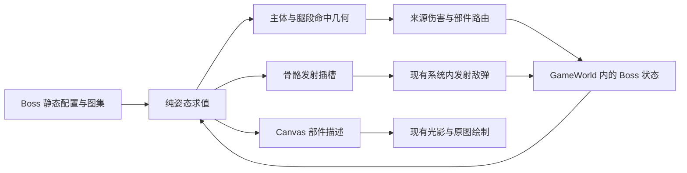

# 野猪王与多足机械：美术资源与技能实现方案

日期：2026-10-20。状态：可玩首版已接入；实现、验证与首版限制见 [BOSS_IMPLEMENTATION.md](BOSS_IMPLEMENTATION.md)。

本方案围绕两个区别明确的 Boss 展开：**野猪王用蓄力直线冲锋改变玩家走位，多足机械用逐条断腿改变战场形态。** 两者均采用像素部件骨骼驱动主体，sprite sheet 承担局部形变、表情、破坏和特效。下文的新文件、字段、参数和接口均为拟新增内容；数值是首轮调试起点，不代表已经完成平衡。

下文保留制作前规格和核对基线，供后续验收对照。2026-10-20 已按用户确认的整组规则实现两只 Boss 的技能、骨骼、部件破坏与首版像素资源；完整手感、平衡和逐帧美术精修仍需人工验收。

## 1. 制作前实现与扩展约束（历史 As-Is）

已阅读 `design.md` 第 2 章及敌人、资源、光影、内容扩展相关章节，并核对下列实际消费点。

| 核对项 | 当前实现 | 对新 Boss 的影响 |
| --- | --- | --- |
| 类型与工厂 | `src/game/model/types.ts` 的 `MonsterType=1\|2\|3\|4\|5`；`src/game/runtime/createMonster.ts` 为全部 `isBoss` 初始化跳跃字段 | 拟新增 6=野猪王、7=多足机械；跳跃初始化须限定史莱姆王，不能让新 Boss 继承跳跃状态机 |
| 生成 | `src/game/systems/spawnMonsters.ts` 第五关直接创建类型 5，并与普通怪一起分批 | 加配置不能使新 Boss 出现；需要明确选择与入场规则 |
| 模拟 | `updateWorld.ts` 固定顺序推进；`monsterSystem.ts` 先处理状态与移动，`enemyAttackSystem.ts` 推进攻击 | 保留系统顺序和单 RAF；Boss 模块由现有系统调用 |
| 攻击分派 | `enemyAttackSystem.ts` 中远程/跳跃分支按 `isBoss` 筛选 | 新 Boss 接入时，旧技能必须改为只服务史莱姆王；同时检查接触伤害分支 |
| 命中与伤害 | `projectileSystem.ts` 用敌人中心圆命中；`rules/damage.ts::resolveMonsterDamage` 接收整个 Monster | 尚无骨骼命中、部件 HP 或部件伤害路由；需新增窄接口，不能只换图片 |
| 精灵与光影 | `spriteLayout.ts::monsterSprite` 对所有 Boss 选 `boss`/`boss2`；`LitSprite` 只有 source/dest/flip | 新 Boss 要有独立绘制分派；旋转、关节锚点和多部件光影尚需支持 |
| 图集 | `assets/atlases.ts` 支持显式帧矩形、帧时长和居中锚点；现有 Boss 为 8 帧与 20 帧图集 | 可复用帧矩形与校验；骨骼、逐部件 pivot、非循环 clip 和事件时刻均是新增内容 |
| 结算 | 死亡登记复用 `settleEnemyDeath`；来源伤害/掉落存在差异 | 腿不能伪装成普通 Monster，否则会误发金币、击杀和清场计数 |
| 生命周期 | `GameWorld` 是权威状态；跨关并不清空所有敌弹/特效；待刷 Boss 提前创建 | 新 Boss 的计时从实际激活开始，技能、部件和表现残留须明确清理 |

实际查看了 `public/assets/boss_1.png`、`enemy_1.png`、`player_1.png`：现有风格是斜俯视、深色像素轮廓、块面高光、夸张轮廓和清晰表情。史莱姆王原图带有半透明多触手与武器造型，新 Boss 应对齐像素密度、质感和屏幕尺度，不简单复制其透明身体或触手轮廓。

当前无现成骨骼运行库，不假定项目使用 Godot、Spine 或已有通用事件总线。

## 2. 共用美术与动画规格（To-Be）

### 2.1 视觉规则

- 继续使用斜俯视像素风。源文件按逻辑像素绘制，导出统一放大 2 倍；最近邻采样，透明背景，检查边缘黑底/白边。最终像素密度需与现有素材并排校准。
- 轮廓以深褐黑/蓝黑勾边，主体约 4 档明暗；高光用色块，不烘焙大片柔光。野猪偏赭棕、暗红、骨白，多足机械偏铁灰、青绿、铜锈。
- 危险预警统一暖红边缘和浅色方向纹；青绿色只表示机械材质/能量，不能仅靠颜色判断是否安全。实际危险范围以实线边界区分，装饰电火花、烟尘不造成伤害。
- 不把脚底阴影、预警线和弹道尾迹画进身体图。每个部件保留关节遮盖，旋转时不露透明裂缝。
- 主体位置以地面根节点为准，视觉抬升和身体摆动不改变地面命中范围。图像矩形、身体碰撞体、攻击区域分别配置。

建议初始屏幕尺度：野猪王主体约 300×230 世界像素，机械含腿展开约 430×360；均可大于命中体。与史莱姆王当前约 390×390 的绘制矩形并排验收后调整。

### 2.2 骨骼与 sprite sheet 的职责

| 内容 | 骨骼处理 | sprite sheet 处理 |
| --- | --- | --- |
| 野猪主体 | 重心起伏、抬头/低头、四足步态、獠牙扫动、耳朵与尾部跟随 | 鼻息、眼神、张口、鬃毛炸起、蹄部触地及受击破相 |
| 机械主体 | 8 条独立腿链、落脚位置、失去支撑后的倾斜与下沉 | 装甲三档、核心脉冲、关节受损、断裂截面、碎片与烟火 |
| 机械触手 | 根部转向、分节弯曲、伸展与回收 | 伸缩套筒、尖端开合、通电纹与命中爆闪 |
| 弹幕/场地效果 | 发射点跟随指定骨骼插槽，轨迹由模拟推进 | 子弹循环帧、拖尾、土块、电弧、冲击波与地面预警纹 |

采用 Canvas 上的轻量部件骨骼：父子变换、角度/位移关键帧、插槽和二维两段 IK。野猪不需要 IK；机械腿使用两段 IK 保持落脚。首版不引入 Spine/Pixi/物理软体或另一套渲染引擎。

骨骼动画建议以 12～16fps 的姿态节奏呈现，战斗判定保持 60Hz。角度量化和位置取整只影响绘制；碰撞保留连续精度。禁止把机械触手压成长条整图来模拟伸长。

所有 clip 明确时长、循环方式、插槽、允许中断点；伤害/发射时刻写在模拟配置中，不依赖“某张图是否已播放到”。暂停、丢帧和补步不能漏发或重复发伤害。

## 3. 野猪王：裂鬃冲锋者

### 3.1 造型与识别

体型前重后轻，肩峰和额头巨大，短粗四肢，獠牙向前上方弯曲。背部暗红鬃毛形成锯齿冠，鼻环/破损护额提供王者识别；眼睛保留现有敌人的简洁表情。蓄力时肩膀下压、鼻孔喷白气、前蹄刨地；冲锋时鬃毛后拉、身体前伸，结束时有明显喘息与头部下垂。

冲锋方向在地面为任意角度，主体使用八方向外形：制作 E、NE、N、SE、S 五套方向的身体/头部关键皮肤，其余用镜像形成 W/NW/SW。每套有对应关节坐标，不能只把侧面野猪整张旋转成朝上/朝下。镜像也要转换獠牙、鼻息与蹄部插槽。

### 3.2 骨骼结构

```text
root（地面位置、朝向）
└─ body（肩部重心）
   ├─ chest → head → jaw → tuskSocketL/R
   │                 └─ noseSocket
   ├─ earL / earR
   ├─ mane
   ├─ legFL.upper → lower → hoof
   ├─ legFR.upper → lower → hoof
   ├─ legBL.upper → lower → hoof
   ├─ legBR.upper → lower → hoof
   └─ tailBase → tailTip
```

远侧腿先画，身体覆盖关节，近侧腿与头部按方向分层。root 不随呼吸抖动；伤害碰撞不跟着鼻息、尾巴和鬃毛扩大。

### 3.3 技能 A：刨地蓄力 → 直线冲锋

| 阶段 | 初始时长/范围 | 动作与特效 | 游戏规则 |
| --- | --- | --- | --- |
| 追踪蓄力 | 700ms | 前蹄交替刨地，肩部压低，鼻息；地面方向带缓慢跟随玩家 | 身体停止平移，朝向可调整 |
| 方向锁定 | 450ms | 獠牙闪光，方向带固定并出现短促倒计时纹 | 冻结起点、方向和最长终点；此后不追踪玩家 |
| 冲锋 | 最多 650ms；速度 1400px/s；最远 850px | 四足快速交替、身体拉伸姿态、短残影、两侧扬尘 | 沿锁定直线移动；身体建议半径 75px，使用扫掠碰撞；每次冲锋对玩家最多命中一次 |
| 急停/撞击 | 180ms | 蹄部拖痕；撞障碍出现额头碰撞星与土块 | 接触地图边界或实体障碍提前停止，不能穿障碍继续冲 |
| 喘息 | 普通 1000ms；撞障碍 1600ms | 肩膀下沉、呼吸起伏、鬃毛松弛 | 停止移动，可被伤害；保留清晰输出窗口 |

调试起点：冲锋伤害 12；技能结束后冷却 5000ms。碰撞预警按“身体扫过的走廊”绘制，标出障碍截断处；不能画出可穿墙的假路线。锁定前可重算截断，锁定后路线固定，障碍若未变化则不再改变终点。

碰撞计算使用 Boss 相对玩家的移动轨迹，避免玩家和 Boss 同时高速移动时穿透。命中后不触发同一步通用接触伤害；击退也经过现有障碍与边界约束。

对策：等路线锁定后横移，或引导其撞障碍。冲锋期间可被正常伤害，不设置隐藏无敌。

### 3.4 技能 B：双蹄震地 → 碎岩扇幕

| 阶段 | 初始参数 | 动作与弹幕 |
| --- | --- | --- |
| 抬蹄预警 | 650ms | 前半身抬起，腹部暴露，地面出现近身圆与面向玩家的扇形 |
| 第一踏 | 时刻 650ms | 落蹄扬尘，近身半径 110px 伤害 8；朝锁定方向发 9 枚碎岩，覆盖 100° |
| 第二踏 | 间隔 500ms；间隔前重新预警 | 身体左右换重心，再发 9 枚；方向重新锁定后留至少 300ms 提示 |
| 恢复 | 800ms | 獠牙抬起，四足重新落地 |

碎岩调试起点：速度 260px/s、碰撞半径 10px、射程 700px、伤害 5。弹体沿直线运行，8 帧翻滚、短尘尾；相邻弹体保留可通行间隙，不产生持续伤害地板。地面震波为表现，只有踏地的明确圆区与碎岩本体有伤害。

共享一次踏击的命中记录，避免圆区与刚生成的碎岩在近身重复扣血。技能结束冷却建议 6000ms。踏地过程中不叠加冲锋。

### 3.5 低血量变化与完整动作集

HP≤40% 时鬃毛变亮、鼻息更密，冲锋可使用两次连招；每次都重新显示锁定阶段，第二次仍保留至少 700ms 总预警。没有突然转弯或零提示回冲。首版可先关闭连冲，确认基础两技能可玩后启用。

必做动作：入场跺脚、待机呼吸、四足行走、刨地蓄力、锁定瞬间、冲锋、撞击眩晕、抬蹄、踏地、受击、喘息、死亡侧倒。死亡时獠牙落地、身体侧翻、尘云散开；不复用史莱姆跳跃帧。

### 3.6 美术资源清单

下列均为建议导出规格；图集允许缩小到实际使用范围，帧矩形必须显式登记，不以图片宽度猜帧数。图集单元数是容量，不能当作已绘制帧数。

| 拟新增资源 | 内容与最低交付量 | 建议导出规格 |
| --- | --- | --- |
| `public/assets/bosses/boar_king/parts.png` | 五方向 body/head/chest-or-mane/tusk 皮肤，共约 20 块；近/远腿的 upper/lower/hoof 6 块；耳、尾等约 6 块；每方向插槽数据 | 2048×2048，常用 256×256 单元，大部件可跨单元 |
| `.../face.png` | 每个基准方向 8 个局部状态：正常/闭眼/怒视/蓄力鼻部/张口等，共 40 帧；随头部变换贴合 | 512×512，64×64 单元 |
| `.../effects.png` | 鼻息 4 帧、蹄尘 6 帧、冲锋尘 6 帧、撞击 8 帧，共 24 帧 | 1024×512，128×128 单元 |
| `.../rock_projectile.png` | 碎岩翻滚 8 帧；命中效果复用专用撞击帧 | 256×128，64×64 单元 |
| 骨骼与 clip 数据 | 五方向挂点；idle/walk/windup/charge/stomp/stun/death 及过渡；鼻部、双蹄和獠牙插槽 | 拟放 `src/game/config/bosses/boarKingArt.ts`；静态 TypeScript 数据 |

资源预览必须展示五个原始方向、八方向组合、完整骨骼测试、冲锋三阶段、两次踏击和死亡末帧。单张效果图不能代替可用的部件图集与动作。

## 4. 多足机械：八足断肢机

### 4.1 造型与轮廓

建议八足，左右各四条，中央为矮扁锅炉/反应核心，青绿观察眼与外露铜线。长腿呈折线支撑，末端是带发射孔的抓地爪。两条可伸长的分节触手从上肩两侧伸出，与承重腿有不同末端形状，保持识别。

整体偏圆形核心，不需要野猪式八方向整套皮肤；移动方向主要由腿步态和传感器朝向表达。每条腿有固定 ID：L1～L4、R1～R4（由前向后），镜像只复用美术，不改变 HP、命中或身份。

### 4.2 每条腿的独立骨骼

```text
root
├─ chassis → core / sensor / armor
├─ legL1.hip → upper → lower → foot（其余 7 条同结构，独立数据）
├─ tentacleL.root → seg1 → seg2 → seg3 → seg4 → tip
└─ tentacleR.root → seg1 → seg2 → seg3 → seg4 → tip
```

每腿有独立的 hip 挂点、腿长、膝盖弯向、步态相位、足端落点、当前 HP 与受损阶段。两段 IK 解 upper/lower，foot 为末端姿态；落脚时固定地面目标，抬脚时沿短弧换点，避免整条腿在地上滑行。

正常交替四足支撑，断腿后只调度剩余腿，降低移动速度与底盘高度。不会为每种断腿组合制作整张动画；8 条腿形成 256 种断/不断组合，组合由骨骼与局部换肤表达。半破状态仍可叠加在这些组合上。

### 4.3 完好、半破、完全破坏的美术合同

| 单腿状态 | 阈值（建议） | 必做美术 | 行为变化 |
| --- | --- | --- | --- |
| 完好 | HP > 50% | 完整装甲、完整膝盖、闭合电缆、平稳脚步 | 正常支撑与足端发射 |
| 半破 | 0 < HP ≤ 50% | 缺口装甲、外露骨架/活塞、断线、膝盖裂纹；间歇 4 帧火花 | 步态更慢、少量抖动，仍可攻击；不是整腿换成红色 |
| 完全破坏 | HP = 0 | 独立 8 帧断裂爆闪、脱落的 upper/lower/foot 碎件、底盘接口残桩、烟与垂落线缆 | 取消该腿支撑、命中体和所有尚未发出的足端弹幕；残桩不可再刷伤害 |

半破皮肤需覆盖 upper/lower/foot，完全破坏需有真实残桩与断面；不能只把正常腿透明度调低或直接隐藏。碎件可短暂保留为无碰撞表现，随后消散。

另外制作三张整机组合验收图：八腿完好、混合半破/断腿、八腿全毁且核心外露。底盘自身再有完整装甲、受损装甲、死亡残骸三档；底盘换肤由主体 HP（建议 50%）与死亡驱动，与各腿状态独立。

### 4.4 技能 A：伸缩触手穿刺

| 阶段 | 初始参数 | 骨骼与特效 | 游戏规则 |
| --- | --- | --- | --- |
| 收束瞄准 | 700ms | 一侧触手卷曲，尖端通电，地面窄带跟随玩家 | 底盘停止移动，未发射 |
| 锁定 | 300ms | 线形预警固定，尖端打开 | 锁定路径与尖端目标；不追踪 |
| 伸长 | 250ms；最远 600px | 六节骨链逐段伸展，套筒局部帧切换，尖端产生短电尾 | 按连续胶囊链扫掠碰撞，伤害 9；本次刺击最多命中一次 |
| 停留 | 150ms | 末端钻头/夹爪张开，地面点状电闪 | 不追加隐形持续伤害 |
| 回收 | 400ms | 按原路径回收，各节弯曲恢复 | 回收为安全阶段，地面提示同步关闭 |

左右交替，第二条触手独立预警后再出招，不同时堵住两侧。触手以分节外露长度和根部套筒退入表达伸长，节块基本等宽；建议中段长度变化不超过约 20%，超出部分通过展开/显露更多节段解决。

触手遇实体障碍截断，前摇中的提示也截断；不穿墙、不额外绕障碍寻路。对策是侧移避开窄带，利用触手锁定后输出底盘。首版两条触手不独立受损，腿是主要破坏目标；这是建议范围，后续若加入断触手需另补命中与残骸合同。

### 4.5 技能 B：足端交替齐射

底盘下沉固定，存活腿的足端灯依次点亮，分两组各最多四条腿射击。每条腿发 3 枚能量弹，角度为锁定方向 ±22°/0°；8 条腿完整时共 24 枚，分两轮发出。

初始参数：首轮预警 900ms，第二轮单独保留 450ms 提示；弹速 220px/s、碰撞半径 9px、伤害 4、射程 750px。弹体 8 帧脉冲，短线尾迹，命中出现 6～8 帧电火花。所有弹体朝玩家锁定时的位置发射，生成后不追踪。被障碍拦截时消失。

每次发射前重新读取该腿是否存在、HP>0、Boss 是否存活且阶段为 playing；预警期间打断该腿会取消这一路，已发出的弹体继续飞行。缺少腿时不凭空补齐原发射点，玩家能直观看到破坏带来的收益。

技能以现存可发射腿排序分组，不要求固定一组仍有四条腿；无可用腿的一轮直接跳过。首版不与触手穿刺同时执行，防止预警互相覆盖。

### 4.6 破坏带来的策略与全断腿收尾

建议主体 HP=2400，单腿 HP=160，普通移动速度基准约为现有史莱姆王的 80%。野猪王建议主体 HP=1900；这些仅用于灰盒对照，不作为最终难度。

- 移动倍率：`max(0.25, 1 - 0.10 × 已断腿数)`；八腿全毁时直接停止移动。半破腿使自己的步态更慢，不另叠一套全局减速公式。
- 同侧缺少支撑时，视觉底盘向该侧倾斜并下沉；首版不引入真实刚体倾倒，也不修改主体命中体形状。
- 存活腿（HP>0，包含半破腿）少于 4 条时切入“核心过载”提示；足端齐射仍按剩余腿发射，空缺线路保留。
- 八腿全毁后，取消待发出的足端攻击，底盘落地、核心盖板打开；主体受伤倍率建议 1.25，触手仍可攻击，但放慢攻击间隔。
- 全断腿收尾补充“核心泄压环”：1000ms 径向预警后，12 个等分方向中省去连续 3 个，实际发 9 枚慢弹；固定安全扇区，发射后不追踪或旋转关闭出口。每次换安全扇区前重新预警。
- 全断腿不直接判定胜利，也不进入无法受伤状态；击毁核心才调用 Boss 死亡结算。

核心泄压环是第三种攻击，主要用于全断腿后的收尾。首次入场、半血、全断腿均给玩家至少 1000ms 的无伤害状态转换提示；转换取消未发技能，不突然清除全部已在飞行的弹体。

### 4.7 部件命中与伤害规则（建议，尚未生效）

机械以一个 Monster 持有主体 HP 和 8 条腿的耐久。腿不是独立敌人，不掉落、不增加波次数量、不触发击杀补弹/吸血/处决奖励。

| 来源 | 主体伤害 | 部件伤害与限制 |
| --- | --- | --- |
| 普通弹命中底盘 | 沿现有伤害、暴击、词缀合同结算一次 | 不自动伤害周边所有腿 |
| 普通弹命中一条腿 | 对主体传递本次有效伤害的 35% | 该腿承受本次有效伤害；同一弹不再额外命中重叠底盘或其他腿 |
| 爆炸 | 主体区域被覆盖则按现有来源规则结算一次；仅覆盖腿则只传递部件总伤害的 35% | 覆盖腿共享一次部件预算 D，按覆盖权重分配；总部件扣血≤D，不能每条腿都完整结算 D |
| 燃烧/中毒/毒圈/气场 | 命中腿可给整个 Boss 附加一次符合现有来源政策的状态；持续伤害只扣主体 | 首版不将 DOT 复制到 8 条腿；不同来源的无敌/词缀规则继续沿用现有合同 |
| 腿摧毁 | 仅保留触发它的那次伤害传递 | 不产生额外“腿死亡伤害”，不发击杀收益；不把过量部件伤害再重复传给主体 |

D 指该次攻击沿当前武器与来源规则算出的有效伤害预算；暴击、词缀拦截等不能对主体传递再重复乘算。新部件路由需返回主体实际扣血、部件扣血和破坏结果，供现有吸血/状态/飘字消费；不能把两者相加当作主体伤害。

子弹用上一位置到当前位置的扫掠线段，对腿段胶囊和主体圆求首次命中；选最小 t，重合时以可见外露腿优先。远侧被底盘遮住的腿段不参与该区域的优先命中，避免射底盘却扣隐藏腿。末端关节安排在主体外缘，保证玩家有可瞄准部位。

新 Boss 的同弹命中记录按 Boss ID 去重，腿 ID 仅作子目标。穿透弹可以继续命中后方其他敌人，不能穿过八条腿制造同一 Boss 九次收益；不借本次内容扩展统一普通怪的 R05 穿透政策。

爆炸范围需与新 Boss 的实际部件几何求交，尤其覆盖“火箭命中外伸腿、爆心距核心较远”的路径，不能先按核心距离排除整个 Boss。实现时检查页面爆炸入口与所有消费者，不顺手改普通敌人的来源倍率（R06/R18）。

### 4.8 美术资源清单

| 拟新增资源 | 内容与最低交付量 | 建议导出规格 |
| --- | --- | --- |
| `public/assets/bosses/mech_centipede/body.png` | 底盘完整、装甲受损、死亡残骸 3 帧；第四格放独立核心盖板，不混入底盘帧 | 2048×512，512×512 单元；盖板以显式矩形裁取 |
| `.../legs.png` | 近/远侧 upper/lower/foot × 完好/半破/断裂，共 18 块；8 个接口标识/残桩；约 6 块脱落碎件 | 1536×512，128×128 单元，至少 32 个明确区域 |
| `.../tentacles.png` | 根套筒 4 帧、中节伸展 4 帧、尖端开合/放电 8 帧，共 16 帧；同材质可复用中节 | 1024×512，128×128 单元 |
| `.../core.png` | 待机/蓄能/过载/熄灭各 4 帧，共 16 帧 | 1024×256，128×128 单元 |
| `.../effects.png` | 半破关节火花 8、断腿爆裂 8、烟 8、触手命中 8、底盘落地 8，共 40 帧 | 1024×1024，128×128 单元 |
| `.../projectiles.png` | 足端能量弹 8、核心慢弹 8，共 16 帧；方向与尾迹独立 | 512×256，64×64 单元 |
| 骨骼与 clip 数据 | 8 条腿的挂点/弯向/相位、双触手节长与插槽；步行/穿刺/齐射/断腿/瘫地/死亡 | 拟放 `src/game/config/bosses/mechCentipedeArt.ts` |

必须交付单腿三状态并排图、任意指定腿破坏预览、左右不对称断腿步态、全断腿动作、触手完整伸缩动作。禁止只制作整机的三张图来替代八条独立腿。

## 5. 共用资源装配与像素骨骼渲染

### 5.1 静态数据和素材交付

共用地面预警可增加 `public/assets/bosses/shared/telegraphs.png`：方向箭头、条带纹、圆环边缘与危险闪烁，共约 24～32 帧，建议 1024×512。线段/圆/扇形边界由 Canvas 按真实几何画出，纹理只提供像素外观。

每份资源须有：文件路径和大小写、尺寸、帧矩形、透明留边、局部 pivot、插槽、层级、逻辑像素倍率、clip 时长、是否循环、末帧保持规则。静态配置继续使用 TypeScript 模块；Aseprite 工程等源文件可单独保存，运行时不动态读取编辑器格式，也不使用 `buff_config.xlsx` 调参。

拟扩展 `assets/atlases.ts` 的显式矩形数据；部件 pivot/骨链放在专用美术配置，不把每条骨骼都升级为全局资源 ID。`manifest.ts` 管理实际 PNG，页面仍通过现有 loader 装配。

### 5.2 同一姿态服务绘制与命中

拟新增纯函数 `evaluateBossPose(state, now, config)`，返回骨骼世界变换、部件绘制描述、插槽与可命中几何。它不扣血、不发弹、不生成 ID、不消耗业务随机。机械 IK 的落脚目标由模拟状态保存，不能在绘制时随机生成。

模拟读取固定步时刻的姿态，渲染读取同一状态与模拟时钟；禁止另建 React 骨骼状态或仅在绘制中推进的腿位置。机械的部件破坏必须在下一次姿态求值时同步移除对应命中体。



### 5.3 光影接入的实际工作

现有 `LitSprite` 与 `drawOriginalSprite` 只支持居中和水平镜像。拟以可选 rotation/pivot 扩展描述，默认值保持旧精灵行为；所有调用方、光影准备、阴影、包围盒与测试需一起检查。

逐部件使用静态 PNG 图集，不每帧生成一张新 HTMLImageElement，也不把不断重画的同一 canvas 当作已缓存的静态图片。现有 GPU 按图像身份缓存，动态合成贴图会出现陈旧纹理或持续上传问题。

实施旋转支持时，光照采样位置和法线 xy 分量须随部件变换，镜像也应同步；只把已受光的整块结果旋转会使高光方向错误。阴影宜采用每个 Boss 一个底盘/身体主阴影，加少量脚点接触阴影，不能每块骨片都叠一个完整黑影。

绘制层级建议：地面预警/主阴影 → 远侧腿 → 后侧触手 → 主体 → 近侧腿/头部与核心 → 前侧触手 → 发光与命中特效 → 原有 HUD/伤害字。预警边界须在烟尘与残影之上保持可读。

所有必需部件在允许生成该 Boss 前加载完成；失败走现有资源失败/重试提示。不能加载失败仍生成无法辨认的攻击者。可选烟尘缺失可降级，但预警和实际命中位置必须保留；WebGL 不可用时，骨骼和 sprite sheet 仍走 Canvas 原图路径。

按上述最大图集规格，新 PNG 的解码 RGBA 约 36MiB，尚不含现有资源、GPU 副本、法线和合成画布；这是容量估算，不是实测。应优先裁掉空白、复用静态腿节，并按实际纹理页与既有 64MiB 新增 GPU 预算统计。首版只安排一只 Boss 同屏，不承诺所有资源同时驻留后的性能。

## 6. 代码接入与状态生命周期（拟实现）

### 6.1 最小合理模块划分

| 入口/模块 | 拟改动 | 兼容要求 |
| --- | --- | --- |
| `model/types.ts`、`config/monsters.ts`、`runtime/createMonster.ts` | 类型 6/7、基础配置、按种类初始化 Boss 状态 | 类型 1～5 保持；史莱姆跳跃字段不再应用到所有 Boss |
| 拟新增 `config/bosses/` | boarKing、mechCentipede 的技能/骨骼/资源数据 | 类型、单位、默认值明确；配置不保存局内 HP 或升级 |
| 拟新增 `model/bossTypes.ts` | 用 kind 区分野猪和机械的状态联合 | 不向 Monster 添加几十个彼此无关的可选字段；首版不迁移史莱姆全部旧字段 |
| 拟新增 `rules/bossPose.ts` | 骨骼变换、有限两段 IK、插槽、几何描述 | 纯求值，不持有第二份 World |
| 拟新增 `rules/bossDamage.ts` | 新 Boss 主体/部件目标选择与伤害分配 | 复用现有伤害和死亡入口；保留来源政策 |
| `monsterSystem.ts` | 状态处理后调用新 Boss 移动/支撑更新 | 从 updatedMonster 继续；新 Boss 特殊移动不再进入旧 Boss 穿障碍分支 |
| `enemyAttackSystem.ts` | 调用拟新增 `systems/bosses/boarKing.ts`、`mechCentipede.ts`；处理技能、敌弹与伤害窗口 | 旧远程/跳跃/旋转弹幕限定类型 5；通用接触伤害不得与新技能叠算 |
| `projectileSystem.ts`、页面爆炸入口、相关规则 | 新 Boss 几何与部件路由；标记同弹已命中的 Boss | 检查暴击、穿透、RPG、附加状态、吸血和死亡结算消费者 |
| `assets/manifest.ts`、`assets/atlases.ts`、页面装配 | PNG、帧矩形、必要资源检查 | 检查完整路径与大小写，不只修改 manifest |
| `renderWorld.ts`、`render/lighting/` | 按种类生成多部件描述；旋转、阴影、HUD预警 | 普通敌人和史莱姆绘制不回退为新 Boss 逻辑 |
| `spawnMonsters.ts`、`waveSystem.ts` | Boss 选择、待刷激活计时、入场位置 | 明确检查工厂创建时间与真实激活时间 |
| `World.ts`、`View.ts`、`createRun.ts`、阶段入口 | 必要 UI 摘要、表现清理、重置 | View 只读；骨骼与腿 HP 不复制成 React 权威状态 |

这些拟新增函数/文件尚不存在。实施时先逐个搜索签名、再导出、工厂和消费者；不为两只 Boss 建立插件框架、全局事件总线或通用 ECS。

### 6.2 状态字段与所有权

| 拟新增状态 | 初始化/修改方 | 重置与阶段行为 |
| --- | --- | --- |
| `boss.kind/phase/phaseStartedAt/skillSequence` | 工厂设 inactive；实际激活时设 idle 与时间；攻击系统推进 | 死亡取消窗口；新关新实体；新局彻底重建 |
| 锁定目标、方向、终点、命中记录 | 技能进入锁定/伤害阶段时设置 | 技能结束/中断即清空；不能沿用下一次冲锋 |
| 野猪朝向与动画阶段 | 移动/攻击系统 | 由阶段求姿态；不另开动画定时器 |
| 机械 `legs[8]` 的 HP、落脚目标、步态相位 | 工厂建固定 ID；伤害规则扣耐久；移动系统更新落脚 | 死亡后不再攻击；新关/新局恢复配置初值 |
| 机械触手目标、伸展进度、发射轮次 | 攻击系统 | 中断回安全收回姿态；暂停冻结 |
| 特效/敌弹的 `ownerId` 与可选 `partId` | 实际发出时以 runtime.nextId 分配 | 取消待发任务不等于删除已发实体；按下述规则收尾 |

所有战斗时间使用 `runtime.now()` / `schedule()`，新速度统一 px/s，时长 ms、角度 rad（作者表可用 degree 后转换）。现有移动/敌弹部分字段按固定步位移使用，新值进入旧消费者时须显式转换 `px/s × dt`，不能把 1400 直接当每步位移。

暂停/失焦沿用现有模拟冻结。Boss 死亡或离开 playing：取消它未执行的发射/穿刺，移除附着式危险区与触手伤害窗口；死亡动画和碎件只留表现。已发出的自由敌弹在本场战斗继续，关卡退出前清除这两个新 Boss 的 owner 标记敌弹及危险区，防止升级/商店后出现无来源攻击；这只是新内容的建议合同，不擅自重定义旧实体的跨关保留政策。

若用了延迟回调，每次执行须重新检查 run、playing、存活的 owner、技能序号和对应腿 HP。`transaction` 只合并发布，没有回滚，不能先错误扣血再指望事务撤销。

### 6.3 敌弹、表现与音效

复用 `EnemyBullet` 生命周期，拟增加可选视觉种类和来源标记，缺省仍走旧敌弹表现。野猪碎岩、足端能量弹、核心慢弹分别选图集，不能统一变成史莱姆火球。

发射插槽的位置在模拟发射时求值；尾迹/闪光在绘制中只读插槽与实体。纯视觉扰动用稳定种子或独立表现随机，不能消耗 `runtime.random()` 改变战斗结果。

音效最小清单：野猪低吼、刨地、冲刺风声、撞墙、双踏；机械步行伺服、锁定充能、触手伸缩、半破电火、断腿金属爆裂、核心过载与熄灭。接入 `useSound` 已有回调，限制多腿同时触发的音量/数量；不把音频时钟当作伤害时钟。

### 6.4 出场与需要保留的玩法边界

开发验收提供可直接选择三只 Boss 的隔离入口或现有测试夹具，避免每次打到第五关。正式关卡建议保留第五关单 Boss 槽，三者等权抽取，使用 `runtime.random()`；这是待产品确认的推荐，不直接修改现有出场规则。若仍与普通怪同批，需要专门验证冲锋走廊和弹幕可读性。

出生点按主体与支撑范围检查世界边界和障碍；待刷激活时再检查，不把出界位置或关卡开始时的旧坐标直接用于技能。

建议新技能均尊重玩家现有闪现免伤窗口；同次攻击仅伤害一次，普通接触伤害在技能窗口关闭。该政策只列为新 Boss 推荐，现有 R16 所述史莱姆落地是否穿透闪现免伤仍待确认，不能借扩展静默改变旧政策。

## 7. 前置债务与实施批次

### 7.1 真正相关的前置项

| 条目 | 现状与扩展影响 | 本方案处理 |
| --- | --- | --- |
| R04 Boss 旧对象写回 | 当前普通移动 Boss 分支仍从原 monster 返回，可能覆盖前面的 DOT/状态更新 | 在新 Boss 接入同一处理链前做局部修复并补真实路径回归；本次文档未修复 |
| R07 击退覆盖 | 状态位移与移动写回可能冲突 | 新 Boss 必须明确冲锋是否接受普通击退；建议冲锋锁定期间抗位移，正常与恢复阶段接受既有击退。实施前确认该新规则，不能顺手改全体敌人 |
| R06 爆炸命中范围 | 大体积目标或外伸腿命中后，核心中心可能在爆炸半径外 | 新机械必须测外伸腿触发爆炸；不要复制“只按核心中心过滤” |
| R16 阶段/闪现免伤 | 旧 Boss 落地与其他来源政策不同 | 新技能伤害需显式选择政策；不将旧例外当默认 |
| R17 生命周期 | 待刷提前计时，跨关实体保留 | 实际激活初始化与按 owner 收尾纳入新 Boss 必做项 |
| R24 状态类型 | Monster 已有多组可选 Boss 字段 | 用窄的带 kind 状态联合扩展，不要求全量重写旧类型 |

### 7.2 制作顺序与每批交付

| 批次 | 制作内容 | 完成判据 |
| --- | --- | --- |
| P0 视觉与玩法定稿 | 野猪五方向草图、机械八足挂点与单腿三状态样张；确认新 Boss 免伤/击退/出场建议 | 轮廓、像素密度、命中范围与玩法规则可评审；仍不是游戏功能 |
| P1 骨骼灰盒 | 简色部件、野猪四足、机械八足 IK、双触手、可视化命中体 | 任意腿可独立选中与打断；暂停一致；绘制无副作用；新 Boss 不执行史莱姆技能 |
| P2 野猪可玩 | 两个基础技能、碰撞、预警、正式部件与特效 | 冲锋锁线、不穿障碍、不重复命中；双踏扇幕有清晰躲避路线 |
| P3 机械可玩 | 部件伤害、半破/断腿、触手、足端齐射、全断腿收尾 | 八腿分别可破坏，火箭/穿透/状态组合可验证，无断腿击杀奖励 |
| P4 表现与集成 | 完整 sprite sheet、音效、光影与原图路径、阶段清理、正式生成 | 完成相关自动检查和人工验收记录；更新 design 对应章节，按证据更新债务状态 |

先做单腿三状态和一套完整冲锋，再批量生产其余资源，能尽早暴露 pivot、方向皮肤和破坏表现问题。AI 生成图可作为概念/部件底稿，最终图集仍需像素修整、统一关节、帧间对齐和透明边缘验收；不能把一次生成的长图直接视为可用动画。

## 8. 验收方案

### 8.1 后续实现时的自动检查

依赖就绪后按范围运行：

```powershell
pnpm test:game
pnpm exec tsc --noEmit --incremental false
pnpm lint:build
pnpm check:assets
```

仅需验证生产行为时单独执行 `pnpm exec next build --webpack`，不与类型检查并行。复用 `scripts/register-typescript.cjs` 与现有测试组织；不新增大型框架。不使用带安装/端口强杀副作用的包装命令充当只读检查。

针对性回归覆盖实际 updateWorld 与技能消费路径：

- 三种 Boss 生成/待刷激活：新 Boss 不进入史莱姆跳跃/旧火球逻辑；待刷很久也不在首步突然攻击。
- 冲锋锁定前追踪、锁定后直线、障碍截断、世界边缘、相对移动扫掠；高刷新率/补步时命中次数一致。
- 双踏时序、近身圆与碎岩去重；技能结束与死亡后无额外发射。
- 机械八腿各自从完好→半破→断裂；一次大伤跨两个阈值只爆裂一次；受损腿不影响其他腿身份。
- 单弹重叠多个部件、穿透后命中其他敌人、爆炸仅覆盖腿/同时覆盖核心、多腿预算上限、暴击与状态附加次数。
- 主体致死与断腿同一步、同一步 DOT+弹体+爆炸：Boss 只结算一次死亡奖励，腿始终没有击杀收益。
- 断腿发生在预警、发射前一步、触手攻击中；断腿减少对应弹幕，已发弹不倒退，触手行为按明确规则中断或继续。
- 暂停/失焦/死亡重开/离开 playing/下一关：时钟、owner 清理、延迟回调均符合生命周期表。
- 动画求值与绘制只读，镜像不交换腿 HP，光影与原图的部件位置/角度一致，资源缺失不生成不可读 Boss。

### 8.2 人工验收操作与预期

| 操作 | 预期 |
| --- | --- |
| 同屏并排查看玩家、史莱姆王、新 Boss | 轮廓、像素块、明暗层级与屏幕体量协调，放大后没有平滑插值糊边 |
| 野猪八方向走动并向上下左右冲锋 | 四足挂点稳定，没有侧面图竖着旋转的违和；预警宽度覆盖真实身体扫过范围 |
| 锁定后横移，并引导野猪撞地图障碍 | 方向不追踪，撞击提前停止并进入可见硬直；不在背后补一次接触伤害 |
| 近身与远处分别躲双踏 | 近身圆、第二踏提示与碎岩能区分；弹幕间隙可实际通过 |
| 单独打 L1，再打 R4，随后任意组合断腿 | 三档破损有不同轮廓；只有选中腿掉耐久/失去发射，底盘倾斜方向合理 |
| 朝腿与核心重叠处射击，使用手枪/狙击/RPG | 命中飘字和破损部位一致，穿透/爆炸不制造九次主体收益 |
| 触手前摇时横移，站障碍后测试 | 锁线后不追踪；触手沿提示伸缩；障碍正确截断；安全回收期不扣血 |
| 断掉全部八腿后继续战斗 | 有清晰瘫地/核心暴露，仍能完成击杀；泄压环有固定安全扇区 |
| 在前摇、冲锋、断腿爆裂时暂停，再恢复 | 不偷跑动画或伤害，不补发多轮弹幕 |
| Boss 死亡/切升级/商店/新局 | 未发技能取消；对应危险区和跨关来源弹清理；重开没有旧腿、旧锁定或旧触手 |
| 关闭光影或触发 WebGL 回退 | 动作、破损与预警仍完整；开启光影后旋转腿的受光方向正确 |

人工试玩再记录各 Boss 击杀时长、玩家受伤来源、断腿收益、冲锋躲避成功率和弹幕密度。自动测试不能替代手感、像素动画质量或平衡结论。

## 9. 本次交付与待确认项

本次交付为资源规格、动作和技能设计、骨骼与部件伤害方案、源码接入清单和后续验收办法。已进行源码与现有图片核对；未生成正式 PNG、未运行游戏、未执行战斗/类型/构建检查，原因是本次仅制作方案。

建议值均可作为下一步灰盒制作的输入。正式落地前集中确认：第五关 Boss 选择方式、新技能是否全部尊重闪现免伤、野猪冲锋期间的抗击退、机械部件伤害传递比例与全断腿核心暴露倍率。上述决定不阻止先制作概念图、分层部件、单腿三状态和隔离动作预览。


## 10. 实现状态（2026-10-20）

用户已确认整组建议：第五关三 Boss 等权随机、新技能尊重闪现免伤、冲锋锁定及冲锋期间抗击退、腿传伤35%、全断腿核心受伤1.25倍。已有可玩首版与隔离试玩参数；本文第9节的“本次”指原制作前方案交付，不再代表当前代码状态。详见 [实施记录](BOSS_IMPLEMENTATION.md)。
